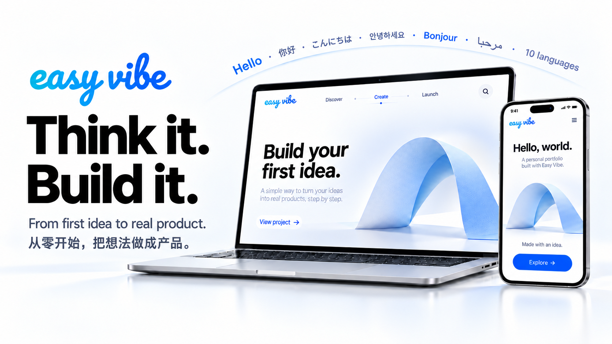
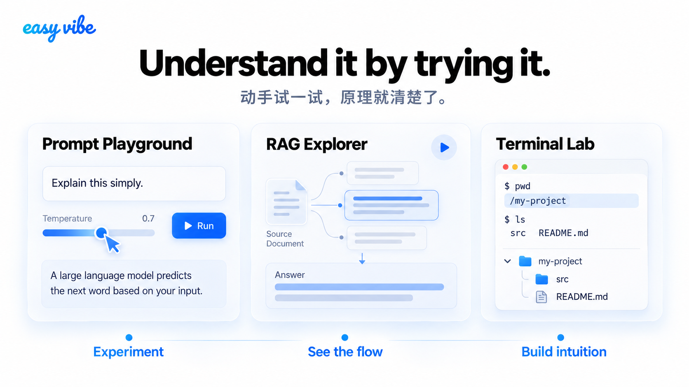
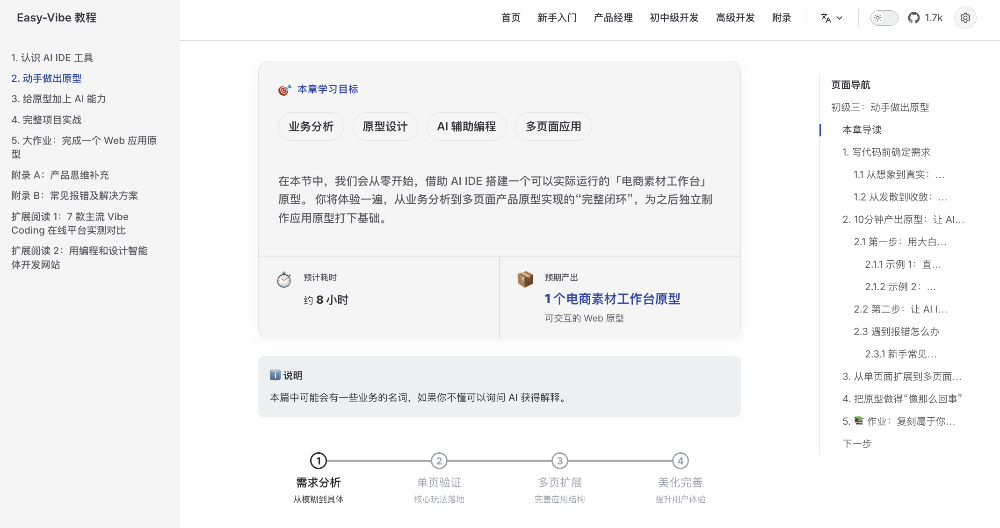
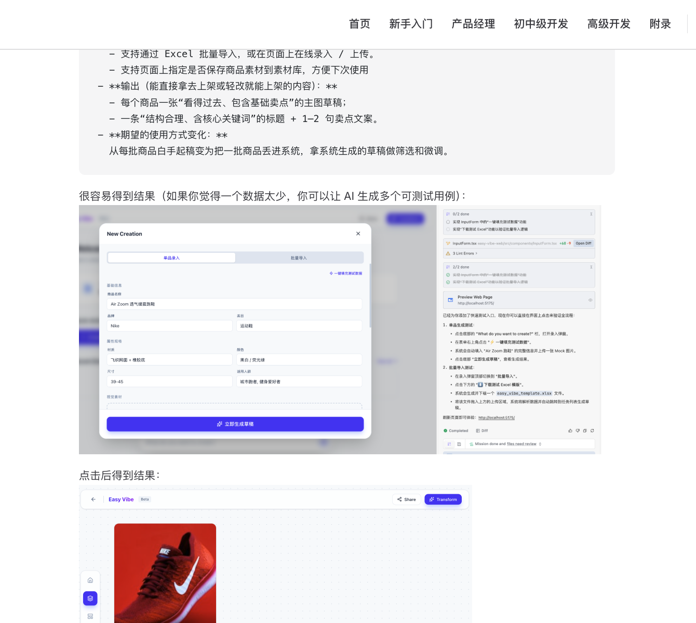
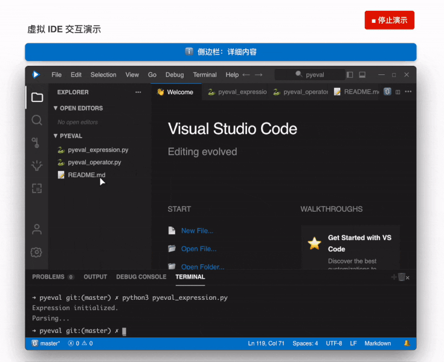
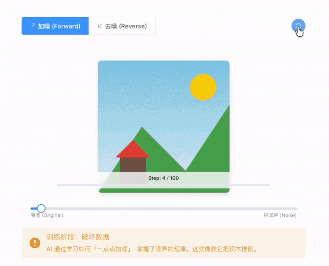
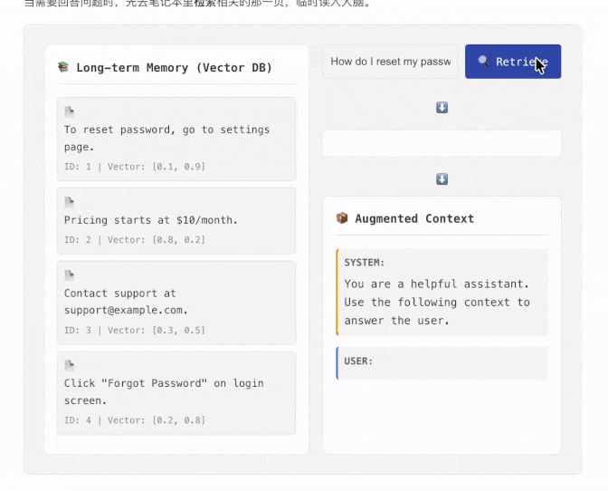
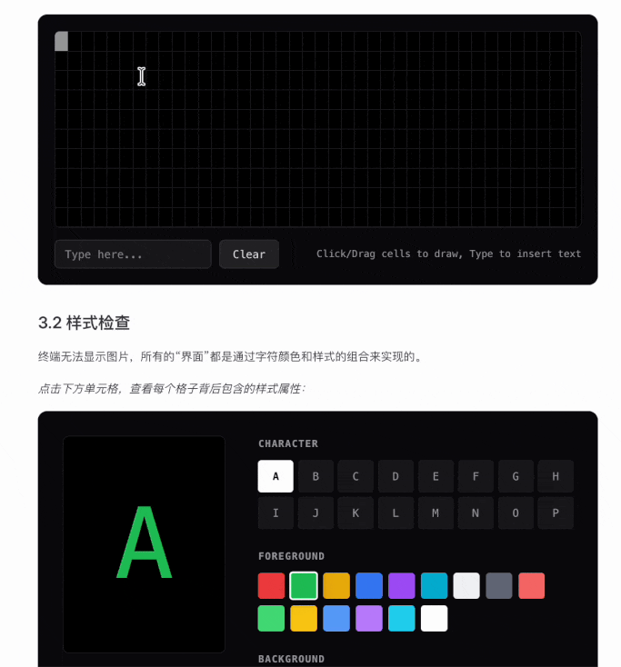
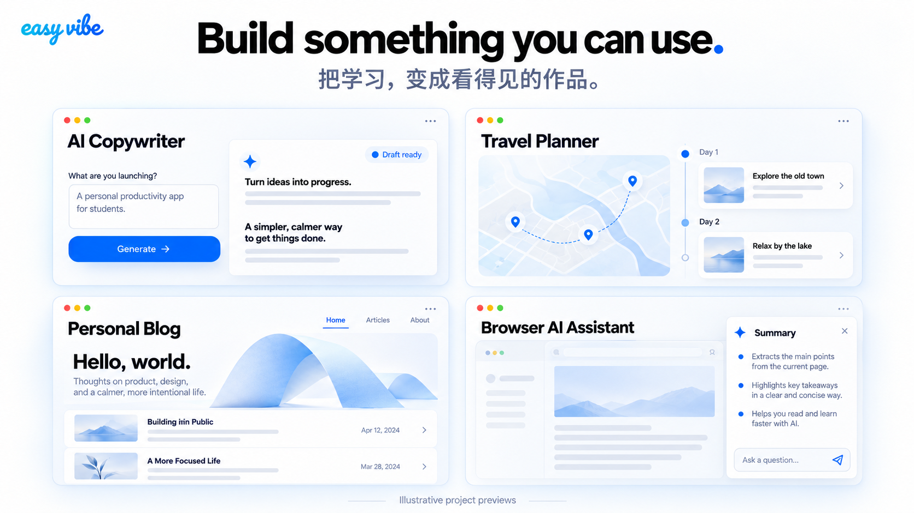
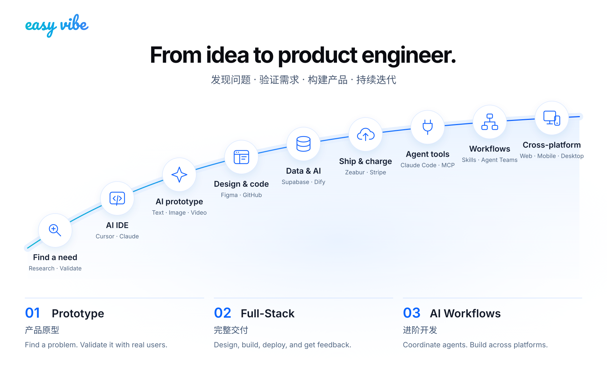

<!-- trigger vercel build -->
<div align="center">



<p align="center" style="font-size: 1.2em; color: #666; margin: 20px 0;">
  <strong>من Vibe Coding إلى منتجات حقيقية. اختاره عشرات الآلاف من المتعلمين.</strong><br>
  نطوره باستمرار اعتمادًا على التدريس الفعلي وملاحظات المتعلمين. مسار متكامل وشروحات دقيقة وعروض تفاعلية ترافقك من البداية حتى إطلاق منتجك.<br>
  <span style="font-size: 0.9em; color: #888;">A hands-on Vibe Coding guide chosen by tens of thousands of learners.<br>Refined through real teaching and learner feedback. A complete roadmap, step-by-step explanations, and interactive demos guide you from zero to launch.</span>
</p>

<a href="https://trendshift.io/repositories/22079" target="_blank"></a>

<p align="center" style="font-size: 1.05em; color: #666; margin: 16px 0;">
  你好 · Hello · 哈囉 · こんにちは · 안녕하세요 · Hola · Bonjour · Hallo · مرحبا · Xin chào<br>
  من إنشاء النماذج الأولية للمنتجات وتطوير الواجهات الأمامية والخلفية إلى تدفقات العمل المعتمدة على الذكاء الاصطناعي، أصبح المنهج الأساسي كاملًا متاحًا بعشر لغات. حوّل فكرتك إلى منتج مع متعلمين من جميع أنحاء العالم.<br>
  <span style="font-size: 0.9em; color: #888;">From product prototyping and full-stack development to AI-native workflows, the full core curriculum is available in 10 languages.</span>
</p>

<p align="center">
  🚀 <a href="https://datawhalechina.github.io/easy-vibe/welcome.html">ابدأ الآن</a> · ✨ <a href="https://datawhalechina.github.io/easy-vibe/en/appendix/">دليل تفاعلي</a> · 🦞 <a href="https://github.com/datawhalechina/hello-claw">تعلّم OpenClaw</a> · 📖 <a href="#table-of-contents">جدول المحتويات</a><br>
  <span style="font-size: 0.85em; color: #888;">🚀 <a href="https://datawhalechina.github.io/easy-vibe/welcome.html">开始体验</a> · ✨ <a href="https://datawhalechina.github.io/easy-vibe/zh-cn/appendix/">交互式教程</a> · 🦞 <a href="https://github.com/datawhalechina/hello-claw">学习 OpenClaw</a> · 📖 <a href="#table-of-contents">查看目录</a></span>
</p>

<p align="center">
  <a href="https://datawhalechina.github.io/easy-vibe/welcome.html">اقرأ عبر الإنترنت</a> ·
  <a href="#-content-navigation">خريطة التعلّم</a><br>
  <span style="font-size: 0.85em; color: #888;">
    <a href="https://datawhalechina.github.io/easy-vibe/welcome.html">开始阅读</a> ·
    <a href="#-content-navigation">学习地图</a>
  </span>
</p>

<p align="center">
    <a href="https://github.com/datawhalechina/easy-vibe/stargazers" target="_blank">
        </a>
    <a href="https://github.com/datawhalechina/easy-vibe/network/members" target="_blank">
        </a>
    <a href="../../LICENSE" target="_blank">
        </a>
</p>

<p align="center">
  <a href="../zh-CN/README.md"></a>
  <a href="../zh-TW/README.md"></a>
  <a href="../en-US/README.md"></a>
  <a href="../ja-JP/README.md"></a>
  <a href="../es-ES/README.md"></a>
  <a href="../fr-FR/README.md"></a>
  <a href="../ko-KR/README.md"></a>
  <a href="../ar-SA/README.md"></a>
  <a href="../vi-VN/README.md"></a>
  <a href="../de-DE/README.md"></a>
</p>

</div>

<p align="center">
  <a href="https://datawhalechina.github.io/easy-vibe/ar-sa/appendix/">
    
  </a>
</p>

<table align="center">
  <tr>
    <td width="50%" valign="top" align="center">
      
      <br>
      <strong>خريطة تعلّم للمبتدئين</strong>
      <br>
      <sub>إرشاد واضح من الصفر، لتنسى مشكلة "تعلّم ونسي"</sub>
    </td>
    <td width="50%" valign="top" align="center">
      
      <br>
      <strong>دروس مرئية خطوة بخطوة</strong>
      <br>
      <sub>شروحات مفصّلة كأنك تتعلم مع معلّم خاص</sub>
    </td>
  </tr>
  <tr>
    <td width="50%" valign="top" align="center">
      
      <br>
      <strong>برمجة محاكاة غامرة</strong>
      <br>
      <sub>فأر افتراضي يرشدك لتعلّم سير عمل IDE بسرعة</sub>
    </td>
    <td width="50%" valign="top" align="center">
      
      <br>
      <strong>مبادئ الذكاء الاصطناعي المرئية</strong>
      <br>
      <sub>شروحات متحركة تسهّل رؤية كيف تولّد الذكاء الاصطناعي الصور</sub>
    </td>
  </tr>
  <tr>
    <td width="50%" valign="top" align="center">
      
      <br>
      <strong>تعلّم RAG كأنك تلعب لعبة</strong>
      <br>
      <sub>مكونات تفاعلية تتيح لك النقر عبر تدفق بيانات RAG الكامل</sub>
    </td>
    <td width="50%" valign="top" align="center">
      
      <br>
      <strong>مفاهيم الطرفية المرئية</strong>
      <br>
      <sub>سلوك سطر الأوامر يصبح حدسيًا عند تصور المنطق الأساسي</sub>
    </td>
  </tr>
</table>
<div align="center">
  <h3>⭐ <a href="https://github.com/datawhalechina/easy-vibe" style="color: #d0cd16ff;">ضع نجمة للمستودع هنا</a> للمساعدة في تسريع التحديثات ❤️</h3>
</div>

<div align="center" style="margin: 30px 0;">
  <a href="../../CONTRIBUTING.md#share-your-case">
    
  </a>
  <p><strong>قد يكون مشروعك هو التالي هنا.</strong><br>نرحب بأدوات التعليم ومشاريع الطلاب والمواقع الشخصية وأول نموذج تجريبي تبنيه.</p>
  <p>أضف قصتك ولقطة شاشة حقيقية أو GIF ورابط العرض أو المستودع إن توفر. اتبع القالب وافتح Pull Request.</p>
  <p>
    <strong><a href="../../CONTRIBUTING.md#share-your-case">شارك مشروعك →</a></strong> ·
    <a href="../../user-cases/TEMPLATE.md">قالب المشاركة</a> ·
    <a href="https://github.com/datawhalechina/easy-vibe/compare?expand=1&amp;template=user_case.md">فتح Pull Request</a>
  </p>
  <p><a href="../../user-cases/README.md">استكشف حالات حقيقية →</a></p>
</div>

## جدول المحتويات

- [لماذا Easy-Vibe](#لماذا-easy-vibe)
- [ما يمكنك بناؤه](#ما-يمكنك-بناؤه)
- [أخبار](#-news)
- [لمن هذا المشروع](#لمن-هذا-المشروع)
- [مسارات التعلّم الخاصة بك](#مسارات-التعلّم-الخاصة-بك)
- [نصائح الدراسة](#نصائح-الدراسة)
  - [أولاً: دخول المبتدئين](#أولاً-دخول-المبتدئين)
  - [ثانياً: المطورون المبتدئون والمتوسطون](#ثانياً-المطورون-المبتدئون-والمتوسطون)
  - [ثالثاً: المطورون المتقدمون](#ثالثاً-المطورون-المتقدمون)
  - [قاعدة المعرفة في الملحق](#-قاعدة-المعرفة-في-الملحق)
- [كيف تتعلم](#️-كيف-تتعلم)
- [التشغيل محلياً](#-التشغيل-محلياً)
- [دورات أخرى](#دورات-أخرى)
- [المساهمة والمساهمون](#-المساهمة-والمساهمون)
- [الترخيص](#-الترخيص)

## لماذا Easy-Vibe

تريد تطبيقا لتتبع الدخل والمصروفات؟ فقط قل ذلك.

تحتاج نظام حجز مع تسجيل دخول عبر WeChat؟ فقط قل ذلك.

تريد مدونة مع تعليقات؟ فقط قل ذلك.

في عصر الذكاء الاصطناعي، تبدأ البرمجة بوصف ما تريده.

Easy-Vibe يعلمك كيف تحول ذلك إلى منتج حقيقي.


## ما يمكنك بناؤه

<p align="center">
  
</p>

تصورات توضيحية للمشاريع. استكشف الدروس المقابلة:

[كاتب نصوص بالذكاء الاصطناعي](https://datawhalechina.github.io/easy-vibe/ar-sa/stage-2/assignments/copywriting-platform-supabase/) · [مخطط رحلات](https://datawhalechina.github.io/easy-vibe/ar-sa/stage-2/assignments/travel-planning-agent-platform/) · [مدونة شخصية](https://datawhalechina.github.io/easy-vibe/ar-sa/stage-3/personal-brand/personal-website-blog/) · [مساعد ذكاء اصطناعي للمتصفح](https://datawhalechina.github.io/easy-vibe/ar-sa/stage-3/cross-platform/browser-ai-extension/)

## 🔥 News

- **[2026-05-20]** 🌍 **اكتمال تغطية المرحلة 1 متعددة اللغات**: اصبحت المرحلة 1 متاحة بالكامل بجميع اللغات المدعومة (zh-cn, en, zh-tw, ja-jp, ko-kr, es-es, fr-fr, de-de, ar-sa, vi-vn)، وتم التحقق من التنقل/البناء لتجنب 404.
- **[2026-03-29]** ✨ **إطلاق قسم قصص المستخدمين وتحديثه بأربع قصص حقيقية**: أضفنا في الصفحة الرئيسية شريط قصص تفاعليًا وصفحات مستقلة للقصص، ثم استبدلنا المحتوى المؤقت بأربع قصص حقيقية لمدرسة ريفية وطالبة جامعية ومعلم تقنية معلومات في الثانوية وسائق شاحنة بنوا منتجات حقيقية باستخدام الذكاء الاصطناعي. [👉 View the stories](https://datawhalechina.github.io/easy-vibe/zh-cn/vibe-stories/story-1.html)
- **[2026-03-26]** 🚀 **تحديث كبير لممارسة المرحلة 2**: اكتمل مشروع SaaS النهائي "[أول تطبيق SaaS full-stack: موقع مولد النصوص](https://datawhalechina.github.io/easy-vibe/en/stage-2/assignments/copywriting-platform-supabase/)" وتم توسيع قسم "[كيفية دمج Stripe وأنظمة الدفع](https://datawhalechina.github.io/easy-vibe/en/stage-2/backend/stripe-payment/)" بشكل كبير.
- **[2026-03-25]** 📚 **ملحق جديد: بحث المستخدم والتحقق من المتطلبات**: تمت إضافة أربع مقالات جديدة تغطي مصادر الأفكار، نموذج Double Diamond، Jobs to Be Done و The Mom Test لمساعدة المبتدئين على اكتشاف أفكار المنتجات والتحقق منها. [👉 قراءة الملحق](https://datawhalechina.github.io/easy-vibe/en/appendix/)
- **[2026-03-25]** 📚 **الوثائق الإنجليزية محدثة بالكامل**: المرحلة 2 (تطوير full-stack) والمرحلة 3 (تطوير متقدم) متاحتان الآن بالكامل باللغة الإنجليزية. [👉 ابدأ التعلم](https://datawhalechina.github.io/easy-vibe/en/stage-2/)
<details>
<summary>أخبار سابقة</summary>

- **[2026-03-02]** 🦞 **دعم ودي لـ OpenClaw و AI Agent**: تمت إضافة `llms.txt` بحيث يمكن لـ OpenClaw و Claude و Cursor و Trae ووكلاء AI الآخرين فهم بنية المستودع بسرعة والعثور على محتوى البرنامج التعليمي المناسب.
- **[2026-03-01]** تمت ترقية قسم [التطوير المتقدم](https://datawhalechina.github.io/easy-vibe/en/stage-3/) بشكل شامل مع أدلة عميقة لـ Claude Code، بما في ذلك MCP و Skills و Agent Teams والمزيد، بالإضافة إلى ثمانية دروس تعليمية لمشاريع متعددة المنصات.
- **[2026-02-25]** تم تحديث [قاعدة معارف الملحق](https://datawhalechina.github.io/easy-vibe/en/appendix/)، وتغطي الآن 9 مجالات معرفية وأكثر من 80 موضوعًا تفاعليًا.
- **[2026-01-27]** تمت إضافة دروس تعليمية لتطوير تطبيقات Android و iOS.
- **[2026-01-19]** تم إصدار عروض تفاعلية لـ Prompt Engineering وتاريخ AI وتصميم المصادقة ومبادئ Git والمزيد.
- **[2026-01-16]** إعادة تنظيم هيكل المشروع وإنشاء رسمي لقسم "مدخل للمبتدئين".
- **[2026-01-14]** إكمال تحديث كبير لمستندات نماذج المنتجات الأولية للمرحلة 1.
- **[2026-01-13]** إعادة بناء بنية الوثائق وتمكين كامل للدعم متعدد اللغات (i18n).
- **[2026-01-01]** إصدار خريطة التعلم الأساسية للمشروع.
</details>

## لمن هذا المشروع

- **المبتدئون تماماً**: ابنِ مشروعك الأول أولاً، ثم افهم كيف يعمل
- **مديرو المنتجات / المؤسسون**: تحقق من أفكارك بسرعة وابنِ MVPs بتكلفة منخفضة
- **الطلاب**: طوّر مهارات عملية لعصر الذكاء الاصطناعي
- **المطورون المبتدئون**: تعلّم المسار الكامل من الفكرة إلى الإطلاق
- **المطورون المتوسطون والكبار**: حسّن سير عمل التعاون مع الذكاء الاصطناعي للمشاريع المعقدة


## مسارات التعلّم الخاصة بك

### 🎮 أريد نجاحاً سريعاً أولاً
**الأفضل ل**: الجميع
**ما ستتعلمه**: ما يشبه البرمجة بالذكاء الاصطناعي من خلال مثال عملي بسيط ومحدد
**ما ستحصل عليه**: انطباع أول واضح عن vibe coding وكيفية العمل مع الذكاء الاصطناعي عبر المحادثة

[ابدأ من هنا](https://datawhalechina.github.io/easy-vibe/en/stage-1/ai-capabilities-through-games/)

### 💡 أريد تحويل فكرة إلى نموذج أولي للمنتج
**الأفضل ل**: المبتدئين / مديري المنتجات / المؤسسين
**ما ستتعلمه**: خارطة طريق التعلم، أدوات AI IDE، التحقق من الأفكار، النماذج الأولية، تكامل قدرات الذكاء الاصطناعي وتكرار العروض الكاملة
**ما ستحصل عليه**: نموذج أولي لمنتج بالذكاء الاصطناعي يمكنك عرضه فعلياً للمستخدمين أو زملائك

[ابدأ التعلّم](https://datawhalechina.github.io/easy-vibe/en/stage-1/learning-map/)

### 🚀 أريد بناء منتجات full-stack من البداية للنهاية
**الأفضل ل**: المطورين المبتدئين / صانعي التطبيقات المستقلين / المتعلمين المتقدمين
**ما ستتعلمه**: سير العمل الأمامي، التصميم إلى الكود، قواعد البيانات، واجهات backend APIs، النشر، الفوترة والمشاريع الكبرى
**ما ستحصل عليه**: القدرة على إطلاق تطبيقات ويب حديثة بالذكاء الاصطناعي بشكل مستقل

[ابدأ التعلّم](https://datawhalechina.github.io/easy-vibe/en/stage-2/)

### AI-Native: أريد سير عمل متقدم مع Claude Code والوكلاء
**الأفضل ل**: المطورين المهتمين بالهندسة الأصلية للذكاء الاصطناعي
**ما ستتعلمه**: Claude Code، MCP، Skills، Agent Teams، المهام طويلة الأمد، Spec Coding وتسليم التطبيقات متعددة المنصات
**ما ستحصل عليه**: سير عمل أقوى للتطوير المعقد بمساعدة الذكاء الاصطناعي والأتمتة

[اذهب إلى التطوير المتقدم](https://datawhalechina.github.io/easy-vibe/en/stage-3/)

### 📚 أريد مواد مرجعية وأساسيات
**الأفضل ل**: الجميع
**ما ستتعلمه**: أساسيات الحوسبة، أساسيات frontend/backend، البنية التحتية، مبادئ الذكاء الاصطناعي وممارسات الهندسة
**ما ستحصل عليه**: قاعدة معرفة مرجعية طويلة الأمد تغطي 9 مجالات معرفية رئيسية

[تصفّح قاعدة المعرفة](https://datawhalechina.github.io/easy-vibe/en/appendix/)

## نصائح الدراسة

- إذا كنت مبتدئاً أو مدير منتج أو مؤسساً، ابدأ بـ [المرحلة 1](https://datawhalechina.github.io/easy-vibe/en/stage-1/learning-map/)
- إذا كنت تريد الانتقال من النماذج الأولية إلى التسليم الكامل، ابدأ بـ [المرحلة 2](https://datawhalechina.github.io/easy-vibe/en/stage-2/)
- إذا كنت تريد سير عمل متقدم مع Claude Code أو مشاريع متعددة المنصات، اذهب إلى [المرحلة 3](https://datawhalechina.github.io/easy-vibe/en/stage-3/)
- إذا أعاقتك المفاهيم أو نقص المعرفة الأساسية، استخدم [قاعدة معرفة الملحق](https://datawhalechina.github.io/easy-vibe/en/appendix/)

### 📖 التنقل في المحتوى

<div align="center">
  
</div>

### أولاً: دخول المبتدئين

| القسم | المحتوى الرئيسي |
| :------ | :---------- |
| [خريطة التعلّم](https://datawhalechina.github.io/easy-vibe/ar-sa/stage-1/learning-map/) | نظرة عامة موجزة لرحلة التعلم الكاملة |
| [عصر الذكاء الاصطناعي: إذا كنت تستطيع التحدث، يمكنك البرمجة](https://datawhalechina.github.io/easy-vibe/ar-sa/stage-1/ai-capabilities-through-games/) | احصل على أول تجربة للبرمجة بالذكاء الاصطناعي عبر أمثلة مثل لعبة Snake |
| [أتقن أدوات البرمجة بالذكاء الاصطناعي](https://datawhalechina.github.io/easy-vibe/ar-sa/stage-1/introduction-to-ai-ide/) | تعلّم كيف تعمل أدوات AI IDE وابنِ مشاريع محلية بسيطة بها |
| [اعثر على أفكار رائعة](https://datawhalechina.github.io/easy-vibe/ar-sa/stage-1/finding-great-idea/) | تعلّم كيف تكتشف وتتحقق من أفكار المنتجات التي تستحق البناء |
| [ابنِ نماذج أولية للمنتج](https://datawhalechina.github.io/easy-vibe/ar-sa/stage-1/building-prototype/) | انتقل من المتطلبات إلى نماذج أولية للمنتج بصفحة واحدة أو متعددة الصفحات |
| [تكامل قدرات الذكاء الاصطناعي](https://datawhalechina.github.io/easy-vibe/ar-sa/stage-1/integrating-ai-capabilities/) | تكامل ميزات الذكاء الاصطناعي للنصوص والصور والفيديو |
| [ممارسة مشروع كامل](https://datawhalechina.github.io/easy-vibe/ar-sa/stage-1/complete-project-practice/) | محاكاة سيناريوهات حقيقية، وجمع تعليقات المستخدمين والتكرار على مشروع كامل |

#### الملحق: التفكير في المنتج والأعمال

| القسم | المحتوى الرئيسي |
| :------ | :---------- |
| [التفكير في المنتج وتصميم الحلول](https://datawhalechina.github.io/easy-vibe/ar-sa/stage-1/appendix-a-product-thinking/) | أطر أساسية للانتقال من الصفر إلى الواحد مع منتج |
| [مرجع سيناريوهات تطبيق الذكاء الاصطناعي (B2B و B2C)](https://datawhalechina.github.io/easy-vibe/ar-sa/stage-1/appendix-industry-scenarios/) | سيناريوهات تطبيقات الذكاء الاصطناعي في الصناعة B2B والاستهلاك B2C |

#### الملحق: بحث المستخدم والتحقق من المتطلبات

| القسم | المحتوى الرئيسي |
| :------ | :---------- |
| [أين تجد الأفكار: 3 مصادر مرجعية تعمل بشكل أفضل للمبتدئين](https://datawhalechina.github.io/easy-vibe/ar-sa/stage-1/appendix-idea-sources/) | ابنِ تدفقاً موثوقاً لإيجاد فرص منتجات ملموسة |
| [Double Diamond: افعل الشيء الصحيح أولاً، ثم افعله بشكل صحيح](https://datawhalechina.github.io/easy-vibe/ar-sa/stage-1/appendix-double-diamond/) | استخدم عملية منظمة للانتقال من الإلهام المشتت إلى اتجاه عملي |
| [استخدم Jobs to Be Done لاكتشاف ما يريده المستخدمون حقاً](https://datawhalechina.github.io/easy-vibe/ar-sa/stage-1/appendix-jobs-to-be-done/) | حلل أهداف المستخدمين من خلال مهام حقيقية بدلاً من طلبات الميزات السطحية |
| [The Mom Test: طريقة مقابلة المستخدمين للتحقق من الطلب](https://datawhalechina.github.io/easy-vibe/ar-sa/stage-1/appendix-mom-test/) | تعلّم كيف تطرح أسئلة أفضل وتتجنب التعليقات الإيجابية الكاذبة |

#### الملحق: الحلول التقنية

| القسم | المحتوى الرئيسي |
| :------ | :---------- |
| [ماذا تفعل إذا واجهت أخطاء](https://datawhalechina.github.io/easy-vibe/ar-sa/stage-1/appendix-b-common-errors/) | مشاكل vibe coding الشائعة وكيفية حلها |
| [مقارنة بين سبع أدوات برمجة بالذكاء الاصطناعي](https://datawhalechina.github.io/easy-vibe/ar-sa/stage-1/appendix-articles/example0-1/vibe-coding-tools-snake-game-tutorial) | قارن منصات البرمجة بالذكاء الاصطناعي الرئيسية عبر اختبارات عملية |
| [صمّم مواقع ويب مع وكلاء](https://datawhalechina.github.io/easy-vibe/ar-sa/stage-1/appendix-articles/example0-2/vibe-coding-tools-build-website-with-ai-coding-and-design-agents) | تعلّم التعاون متعدد الوكلاء في الممارسة |

#### المزيد من تمارين المبتدئين

- [البناء انطلاقًا من لقطة شاشة: أول تمرين محاكاة](https://datawhalechina.github.io/easy-vibe/ar-sa/stage-1/clone-your-favorite-app/)
- [نشر مشروع Vibe Coding على ModelScope](https://datawhalechina.github.io/easy-vibe/ar-sa/stage-1/appendix-modelscope-static-site/)

### ثانياً: المطورون المبتدئون والمتوسطون

#### الواجهة الأمامية (Frontend)

| القسم | المحتوى الرئيسي |
| :------ | :---------- |
| [Frontend 0: ابنِ وكيل إنتاج الأصول الخاص بك مع Lovart](https://datawhalechina.github.io/easy-vibe/ar-sa/stage-2/frontend/lovart-assets/) | استخدم Nanobanana و Lovart لتوليد أصول بصرية دفعة واحدة وابنِ وكيل رسم مع التعرف على النية |
| [Frontend 1: أساسيات Figma و MasterGo](https://datawhalechina.github.io/easy-vibe/ar-sa/stage-2/frontend/figma-mastergo/) | تعلّم سير العمل من مسودات التصميم إلى التفكير في واجهة المستخدم الجاهزة للتنفيذ |
| [Frontend 2: ابنِ تطبيقك الحديث الأول - تصميم UI](https://datawhalechina.github.io/easy-vibe/ar-sa/stage-2/frontend/ui-design/) | تعلّم أساسيات تصميم UI خلف واجهات التطبيقات الحديثة |
| [Frontend 3: إرشادات UI وتصميم متعدد المنتجات](https://datawhalechina.github.io/easy-vibe/ar-sa/stage-2/frontend/multi-product-ui/) | حسّن الاتساق والجمالية عبر منتجات متعددة بقواعد UI مشتركة |
| [Frontend 4: اجعل الواجهات جميلة مع LLMs و Skills](https://datawhalechina.github.io/easy-vibe/ar-sa/stage-2/frontend/llm-skills-beautiful/) | استخدم الأوامر والإضافات لجعل الذكاء الاصطناعي ينتج واجهات أكثر تنقية وتميزاً |
| [Frontend 4: لنبني لوحات هوجورتس معاً](https://datawhalechina.github.io/easy-vibe/ar-sa/stage-2/frontend/hogwarts-portraits/) | ابنِ مشروع واجهة أمامية تفاعلي لصور الذكاء الاصطناعي من الصفر |
| [Frontend 6: من نموذج التصميم إلى كود المشروع](https://datawhalechina.github.io/easy-vibe/ar-sa/stage-2/frontend/design-to-code/) | حوّل نماذج التصميم إلى كود واجهة أمامية يعمل فعلياً في المتصفح |
| [Frontend 7: حدّث واجهتك بمكتبات مكونات حديثة](https://datawhalechina.github.io/easy-vibe/ar-sa/stage-2/frontend/modern-component-library/) | استخدم مكتبات المكونات لبناء واجهات احترافية بشكل أسرع |

#### الواجهة الخلفية (Backend)

| القسم | المحتوى الرئيسي |
| :------ | :---------- |
| [Backend 1: تعلّم Git و GitHub](https://datawhalechina.github.io/easy-vibe/ar-sa/stage-2/backend/git-workflow/) | أتقن عمليات التحكم في الإصدار وسير العمل التعاوني مع Git |
| [Backend 2: من قاعدة البيانات إلى Supabase](https://datawhalechina.github.io/easy-vibe/ar-sa/stage-2/backend/database-supabase/) | تعلّم أساسيات قواعد البيانات العلائقية واستخدم Supabase كمنصة BaaS حديثة |
| [Backend 3: تصميم وتطوير واجهات backend APIs](https://datawhalechina.github.io/easy-vibe/ar-sa/stage-2/backend/ai-interface-code/) | استخدم الذكاء الاصطناعي للمساعدة في تصميم APIs وتوليد كود backend وتوثيق APIs |
| [Backend 4: انشر نموذج منتجك الأولي](https://datawhalechina.github.io/easy-vibe/ar-sa/stage-2/backend/zeabur-deployment/) | انشر تطبيقات full-stack بسرعة على السحابة مع Zeabur |
| [Backend 5: من IDEs إلى أدوات البرمجة بالذكاء الاصطناعي عبر CLI](https://datawhalechina.github.io/easy-vibe/ar-sa/stage-2/backend/modern-cli/) | استكشف سير عمل البرمجة بالذكاء الاصطناعي من الطرفية للتطوير الحديث |
| [Backend 6: تكامل Stripe وأنظمة الفوترة الأخرى](https://datawhalechina.github.io/easy-vibe/ar-sa/stage-2/backend/stripe-payment/) | أضف تحقيق الدخل مع قدرات الدفع والفوترة |

#### المشاريع الكبرى

| القسم | المحتوى الرئيسي |
| :------ | :---------- |
| [المشروع الكبير 1: أول تطبيق SaaS full-stack خاص بك - موقع كتابة محتوى بالذكاء الاصطناعي](https://datawhalechina.github.io/easy-vibe/ar-sa/stage-2/assignments/copywriting-platform-supabase/) | ابنِ مساحة عمل تسويقية بالذكاء الاصطناعي مع تسجيل الدخول والتوليد والفوترة وإدارة المسؤول |
| [المشروع الكبير 2: نظام اختبارات وإدارة عبر الإنترنت](https://datawhalechina.github.io/easy-vibe/ar-sa/stage-2/assignments/exam-management-express/) | ابنِ نظام اختبارات عبر الإنترنت مع توليد الأسئلة وتدفقات الامتحان وأدوات الإدارة |

#### المزيد من المشاريع العملية

| القسم |
| :------ |
| [تطوير SaaS حديث لتوليد الصور بالذكاء الاصطناعي - مشروع عملي](https://datawhalechina.github.io/easy-vibe/ar-sa/stage-2/assignments/modern-landing-page/) |
| [تطوير منصة وكلاء ذكاء اصطناعي مشابهة لـ Dify - مشروع عملي](https://datawhalechina.github.io/easy-vibe/ar-sa/stage-2/assignments/custom-dify-agent-platform/) |
| [تطوير منصة وكيل تخطيط السفر الذكي - مشروع عملي](https://datawhalechina.github.io/easy-vibe/ar-sa/stage-2/assignments/travel-planning-agent-platform/) |
| [تطوير نظام توصية الأفلام باستخدام Spring Boot - مشروع عملي](https://datawhalechina.github.io/easy-vibe/ar-sa/stage-2/assignments/movie-recommendation-springboot/) |
| [تطوير نظام الخدمات المصغرة للتجارة الإلكترونية للمواد الغذائية الطازجة - مشروع عملي](https://datawhalechina.github.io/easy-vibe/ar-sa/stage-2/assignments/simple-grocery-microservices/) |
| [تطوير منصة تحليل بيانات حركة المرور باستخدام Go - مشروع عملي](https://datawhalechina.github.io/easy-vibe/ar-sa/stage-2/assignments/traffic-data-visualization-go/) |

#### ملحق قدرات الذكاء الاصطناعي

| القسم | المحتوى الرئيسي |
| :------ | :---------- |
| [الذكاء الاصطناعي 1: أساسيات Dify وتكامل قاعدة المعرفة](https://datawhalechina.github.io/easy-vibe/ar-sa/stage-2/ai-capabilities/dify-knowledge-base/) | تعلّم بناء تطبيقات الذكاء الاصطناعي مع Dify وتكامل قواعد المعرفة الخاصة |

#### المزيد من دروس التطوير الشامل

- [انشر موقعك على الإنترنت (متقدم): جهّز خادم VPS خاصًا بك](https://datawhalechina.github.io/easy-vibe/ar-sa/stage-2/backend/cloud-server-deployment/)

### ثالثاً: المطورون المتقدمون

#### المهارات الأساسية لـ Claude Code

| القسم | المحتوى الرئيسي |
| :------ | :---------- |
| [البدء مع Claude Code](https://datawhalechina.github.io/easy-vibe/ar-sa/stage-3/core-skills/basics/) | التثبيت والإعداد والأساسيات والأوامر المفيدة |
| [دليل Claude Code MCP](https://datawhalechina.github.io/easy-vibe/ar-sa/stage-3/core-skills/mcp/) | ربط Claude Code بـ GitHub وقواعد البيانات و APIs وخدمات أخرى عبر MCP |
| [دليل Claude Code Skills](https://datawhalechina.github.io/easy-vibe/ar-sa/stage-3/core-skills/skills/) | حوّل خبرتك إلى مهارات قابلة لإعادة الاستخدام مراراً وتكراراً |
| [كيف تجعل Claude Code يعمل لفترات طويلة](https://datawhalechina.github.io/easy-vibe/ar-sa/stage-3/core-skills/long-running-tasks/) | صمّم مهام طويلة الأمد لكي تستمر أدوات الترميز في العمل حتى الانتهاء |
| [دليل Claude Agent Teams](https://datawhalechina.github.io/easy-vibe/ar-sa/stage-3/core-skills/agent-teams/) | نسّق عدة حالات ذكاء اصطناعي كفريق تطوير حقيقي |
| [قوى Claude Code الخارقة للتطوير بمستوى الهندسة](https://datawhalechina.github.io/easy-vibe/ar-sa/stage-3/core-skills/superpowers/) | ساعد الذكاء الاصطناعي في إنتاج كود بمستوى الهندسة مع TDD وأفضل الممارسات |
| [أفضل ممارسات سير عمل Claude Code](https://datawhalechina.github.io/easy-vibe/ar-sa/stage-3/core-skills/workflow/) | أفضل الممارسات لإعادة الهيكلة ومراجعة الكود والتطوير اليومي |
| [تطوير البرمجيات بالذكاء الاصطناعي عبر GitHub Issues: من مناقشة المتطلبات إلى تطبيق macOS مكتمل](https://datawhalechina.github.io/easy-vibe/ar-sa/stage-3/core-skills/github-iterative-development/) | من المواصفات إلى Issues والتنفيذ والاختبارات والمراجعة |
| [التطوير عن بُعد مع Claude Code على الجوال](https://datawhalechina.github.io/easy-vibe/ar-sa/stage-3/core-skills/mobile-development/) | استخدم Claude Code خارج سطح المكتب وابنِ سير عمل عن بُعد منتج على الأجهزة المحمولة |
| [الدليل الشامل لـ SDK Claude Agent](https://datawhalechina.github.io/easy-vibe/ar-sa/stage-3/core-skills/claude-agent-sdk/) | ابنِ سير عمل وكلاء مخصص وادمج Claude في أدواتك الخاصة مع SDK |
| [من vibe coding إلى spec coding](https://datawhalechina.github.io/easy-vibe/ar-sa/stage-3/core-skills/spec-coding/) | انتقل من الأوامر العفوية إلى سير عمل تطوير بالذكاء الاصطناعي أكثر هيكلة وقائماً على المواصفات |

#### التطوير متعدد المنصات

| القسم | المحتوى الرئيسي |
| :------ | :---------- |
| [كيف تختار المنصة المناسبة لتطبيقك](https://datawhalechina.github.io/easy-vibe/ar-sa/stage-3/cross-platform/choose-platform/) | قارن أشكال التطبيقات واختر المنصة المناسبة بناءً على المستخدمين والسيناريوهات وأهداف التسليم |
| [ابنِ برنامج WeChat Mini](https://datawhalechina.github.io/easy-vibe/ar-sa/stage-3/cross-platform/wechat-miniprogram/) | افهم النظام البيئي وانشر برنامج Mini أمامي من القالب إلى الإطلاق |
| [ابنِ برنامج WeChat Mini مع backend](https://datawhalechina.github.io/easy-vibe/ar-sa/stage-3/cross-platform/wechat-miniprogram-backend/) | أضف منطق backend وقواعد البيانات لإكمال حلقة الأعمال الكاملة |
| [ابنِ تطبيق Android](https://datawhalechina.github.io/easy-vibe/ar-sa/stage-3/cross-platform/android-app/) | تعلّم تطوير تطبيقات Android بسير عمل أصلي حديث |
| [ابنِ تطبيق iOS](https://datawhalechina.github.io/easy-vibe/ar-sa/stage-3/cross-platform/ios-app/) | تعلّم تطوير تطبيقات iOS واصطلاحات نظام Apple البيئي |
| [ابنِ تطبيق PWA محلي](https://datawhalechina.github.io/easy-vibe/ar-sa/stage-3/cross-platform/pwa-local-app/) | حوّل موقع ويب إلى تطبيق حقيقي مع دعم عدم الاتصال والإشعارات والتثبيت |
| [ابنِ إضافة مساعد ذكاء اصطناعي للمتصفح](https://datawhalechina.github.io/easy-vibe/ar-sa/stage-3/cross-platform/browser-ai-extension/) | أنشئ إضافة Chrome تلخّص أي صفحة إما بـ APIs سحابية أو ذكاء اصطناعي مدمج |
| [ابنِ تطبيق سطح مكتب Electron](https://datawhalechina.github.io/easy-vibe/ar-sa/stage-3/cross-platform/electron-voice-to-text/) | ابنِ تطبيق سطح مكتب لتحويل الصوت إلى نص مع Electron لثلاث منصات |
| [ابنِ واصنع NFT بسرعة](https://datawhalechina.github.io/easy-vibe/ar-sa/stage-3/cross-platform/nft-minting/) | اكتب عقداً ذكياً من الصفر، انشره واصنع NFT الخاص بك |
| [ابنِ إضافة VS Code](https://datawhalechina.github.io/easy-vibe/ar-sa/stage-3/cross-platform/vscode-extension/) | ابنِ مساعد مشروع بالذكاء الاصطناعي مع قوالب ودردشة كود وأسئلة وأجوبة متعددة الملفات |
| [ابنِ تطبيق سطح مكتب Qt بمستوى صناعي](https://datawhalechina.github.io/easy-vibe/ar-sa/stage-3/cross-platform/qt-industrial-hmi/) | أنشئ نظام HMI Qt في الوقت الفعلي مع الاتجاهات والتنبيهات والمراقبة |

#### ملحق قدرات الذكاء الاصطناعي

| القسم | المحتوى الرئيسي |
| :------ | :---------- |
| [ما هو RAG وكيف يعمل](https://datawhalechina.github.io/easy-vibe/ar-sa/stage-3/ai-advanced/rag-introduction/) | ابنِ فهماً منظماً لمبادئ RAG والبنيات الشائعة |
| [سير عمل RAG المتوسط والمتقدم مع LangGraph](https://datawhalechina.github.io/easy-vibe/ar-sa/stage-3/ai-advanced/langgraph-advanced-rag/) | صمّم سير عمل متعدد الخطوات وأنظمة RAG أكثر تقدماً |

#### المزيد من الدروس المتقدمة

- [من صفحة ويب إلى برنامج حقيقي ثم منتج أصلي للذكاء الاصطناعي](https://datawhalechina.github.io/easy-vibe/ar-sa/stage-3/cross-platform/ai-native-creator/)
- [إنشاء تطبيق تفتيش متجر باستخدام React Native وExpo](https://datawhalechina.github.io/easy-vibe/ar-sa/stage-3/cross-platform/react-native-expo/)
- [تطوير تطبيق متعدد المنصات باستخدام Flutter](https://datawhalechina.github.io/easy-vibe/ar-sa/stage-3/cross-platform/flutter-app/)
- [إنشاء ألعاب منصات وPixel Art وثلاثية الأبعاد باستخدام Godot](https://datawhalechina.github.io/easy-vibe/ar-sa/stage-3/cross-platform/godot-game-development/)
- [نشر التطبيق المكتمل وإرساله إلى المتاجر](https://datawhalechina.github.io/easy-vibe/ar-sa/stage-3/cross-platform/app-publishing/)

### 📚 قاعدة المعرفة في الملحق

> تغطي **9 مجالات معرفية رئيسية** و**أكثر من 80 موضوعاً تفاعلياً**، يستخدم هذا الملحق الرسوم المتحركة والمكونات المرئية لمساعدتك على فهم المفاهيم الأساسية بشكل حدسي من أساسيات الحوسبة إلى حدود الذكاء الاصطناعي.
>
> 👉 [عرض الملحق الكامل](https://datawhalechina.github.io/easy-vibe/en/appendix/)

### 🎓 دورات أخرى

- [Hands-on Modern RL](#دورات-أخرى)
- [Learn Harness Engineering](#دورات-أخرى)

## 🛠️ كيف تتعلم

- اقرأ وتدرّب على الأقسام التي تناسب مستواك الحالي. إذا واجهتك مشكلة، لا تتردد في فتح issue.

## 💻 التشغيل محلياً

### الطريقة الحديثة

في نافذة محادثة AI IDE مثل VS Code أو Cursor أو Trae، يمكنك ببساطة أن تقول:

```text
ساعدني في تشغيل هذا المشروع محلياً.
```

### الطريقة التقليدية

1. `npm install`
2. `npm run dev`
3. افتح `http://localhost:3000` في متصفحك.

## دورات أخرى

فريقنا أنشأ أيضاً دورات أخرى! اطلع عليها:

[](https://github.com/walkinglabs/hands-on-modern-rl)

**Hands-on Modern RL**: منهاج عملي ومفتوح المصدر يسد الفجوة من مفاهيم RL الأساسية إلى محاذاة LLMs و RLVR وأنظمة Agentic المتقدمة.

[](https://github.com/walkinglabs/learn-harness-engineering/tree/main)

**Learn Harness Engineering**: دليل شامل لهندسة الهارنيس.

## 🤝 المساهمة والمساهمون

- إذا وجدت مشكلة أو رأيت شيئاً يمكن تحسينه، لا تتردد في فتح issue. إذا لم يرد أحد، يمكنك أيضاً التواصل مع [فريق دعم Datawhale](https://github.com/datawhalechina/DOPMC/blob/main/OP.md).
- إذا كنت تريد المساهمة، افتح pull request. إذا لم يرد أحد، يمكنك أيضاً التواصل مع [فريق دعم Datawhale](https://github.com/datawhalechina/DOPMC/blob/main/OP.md).
- إذا كنت تريد بدء مشروع Datawhale مفتوح المصدر جديد، يرجى اتباع [دليل مشاريع Datawhale المفتوحة المصدر](https://github.com/datawhalechina/DOPMC/blob/main/GUIDE.md).

### 🙏 المساهمون

- [Sanbu - قائد المشروع](https://github.com/sanbuphy) (عضو في Datawhale)
- Fang Ke - المرشد (عضو في Datawhale، جامعة Tsinghua)
- [Yerim Kang](https://github.com/yerim25) (المشاريع العملية، جامعة Tsinghua)
- [Zhilin Zhao](https://github.com/ChileenZ) (المشاريع العملية، جامعة Tsinghua)
- [Yixuan Li](https://yixuan20.github.io/) (التصميم البصري، جامعة Tsinghua)
- Siyi Liu (المشاريع العملية، جامعة Tsinghua)
- [Lixin Liu](https://github.com/liulx25xx) (المشاريع العملية، جامعة Tsinghua)
- كل من في مجموعة الاختبار الداخلي لـ AI Vibe Coding 101 الذين شاركوا اقتراحاتهم وملاحظاتهم

### شكر خاص

- شكراً لـ OpenAI على توفير موارد الحوسبة اللازمة لتطوير هذا المشروع
- شكراً لـ [@Sm1les](https://github.com/Sm1les) على المساعدة والدعم في هذا المشروع
- شكراً لكل مساهم وكل من دعم المشروع بملاحظاته ونجومه ❤️

<div align="center"> 
 <a href="https://www.star-history.com/#datawhalechina/easy-vibe&type=timeline&legend=top-left"> 
   <picture> 
     <source media="(prefers-color-scheme: dark)" srcset="https://api.star-history.com/svg?repos=datawhalechina/easy-vibe&type=timeline&theme=dark&legend=top-left" /> 
     <source media="(prefers-color-scheme: light)" srcset="https://api.star-history.com/svg?repos=datawhalechina/easy-vibe&type=timeline&legend=top-left" /> 
   </picture> 
 </a>
</div>

<div align=center style="margin-top: 30px;">
  <a href="https://github.com/datawhalechina/easy-vibe/graphs/contributors">
    
  </a>
</div>

## 📄 الترخيص

<div align="center">
<a rel="license" href="http://creativecommons.org/licenses/by-nc-sa/4.0/">
  
</a>
<br />
هذا العمل مرخص بموجب
<a rel="license" href="http://creativecommons.org/licenses/by-nc-sa/4.0/">
  رخصة المشاع الإبداعي Attribution-NonCommercial-ShareAlike 4.0 الدولية
</a>.
</div>

## Star History

[](https://www.star-history.com/#datawhalechina/easy-vibe&type=date&legend=top-left)
