<script setup>
import RelatedArticlesSection from '../../../../.vitepress/theme/components/RelatedArticlesSection.vue'
import { relatedArticlesMap } from '../../../../.vitepress/theme/data/relatedArticles'
</script>

# 把网站发到网上（进阶方式）：自己买台 VPS 服务器搭建发布

> 💡 **什么叫"把网站发到网上"？** 也叫"上线"或"部署发布"。你在本地电脑写好的网站，只有你自己能打开；**"发到网上"就是把它放到一台 24 小时开机的服务器上，让任何一个人在浏览器里输入网址就能访问到**——就像你写了一篇 Word 文档只有自己电脑能看，发到公众号/博客后所有人都能看一样，只不过这次发上去的是一个完整的网站。

上一章我们学了最简单的"一键发布"方式（用 Vercel、Cloudflare Pages、Render 这类平台，连仓库即上线），这一章讲更灵活、也更彻底的方式：**自己买一台云服务器，从头到尾把网站搭起来发布出去**。你会学到怎么选服务器、怎么连接上去、怎么装环境、怎么配 Nginx、怎么绑域名开 HTTPS——搞懂之后，没有任何平台能限制你，想跑什么服务就跑什么。

可以把本章连同项目的技术栈、运行方式和预算一起发给 AI，让它帮助挑选平台并生成集成配置。需要它自动操作时，先说明允许使用的终端、账号和部署权限；真实密码与私钥通过凭证配置提供。

---

# 0. 先选对：部署平台全景决策图

选平台之前，先回答三个问题：

1. **你的项目需要 24 小时在线吗？**
   - 不需要（用户访问时才响应，比如文档站、博客、普通网站）→ 选 **静态托管/PaaS**
   - 需要（定时任务、爬虫、Telegram/Discord Bot、WebSocket 服务）→ 选 **常驻型 PaaS 或 VPS**

2. **你需要 GPU 吗？**
   - 不需要（只调用 OpenAI/Anthropic API）→ 普通平台即可
   - 需要（自己跑开源模型、生成图片/视频）→ 选 **GPU 云平台**（Modal、Replicate、AutoDL 等）

3. **你的用户主要在哪里？**
   - 国内 → 优先评估国内云（阿里云/腾讯云），并在目标用户的实际网络下测试访问效果
   - 海外 → 按运行方式、可用地域与预算比较 Vercel / Railway / Fly.io / AWS
   - 都有 → 用 CDN，国内放国内，海外放海外

根据这三个问题，对应下面的决策路径：

```
你的项目是什么类型？
│
├─ 纯前端静态站（Vite/React/Vue 构建产物）
│   ├─ 静态托管免费方案 → Cloudflare Pages / GitHub Pages（仍有构建、大小等限制）
│   ├─ Next.js 项目 → Vercel（官方平台，体验最好）
│   └─ 国内用户为主 → 国内 OSS+CDN 或其他已实测的托管方案
│
├─ 有后端 API，但不需要 24 小时常驻（请求触发）
│   ├─ 请求触发的 API → Vercel Functions / Cloudflare Workers（先检查语言与依赖兼容性）
│   └─ 全栈框架（Next.js/Nuxt/SvelteKit）→ Vercel
│
├─ 需要常驻进程（Bot、定时任务、WebSocket）
│   ├─ 不想管服务器 → Railway / Render 付费实例 / Fly.io（按所需在线方式选套餐）
│   ├─ 想完全控制 & 省钱 → 买 VPS（腾讯云轻量/阿里云轻量/Vultr/Hetzner）
│   └─ 国内项目 → 腾讯云轻量应用服务器
│
├─ 需要跑 AI 模型/需要 GPU
│   ├─ 推理 API → Modal / Replicate / Hugging Face Inference
│   ├─ 国内 GPU → AutoDL（便宜）/ 阿里云 PAI
│   └─ 训练/Fine-tune → Modal / Lambda Labs / 国内 GPU 云
│
└─ 大型生产项目
    └─ AWS/GCP/阿里云 + Kubernetes（找运维或让 AI 帮你写 Terraform）
```

---

# 1. 免费/低成本部署平台详解（不用买服务器）

对于大多数个人项目、Demo、作品集，你**完全不需要买服务器**。这一节详细介绍各个免费/低成本平台，告诉你怎么注册、怎么用、有什么坑。

## 1.1 Vercel — Next.js 官方平台，前端首选

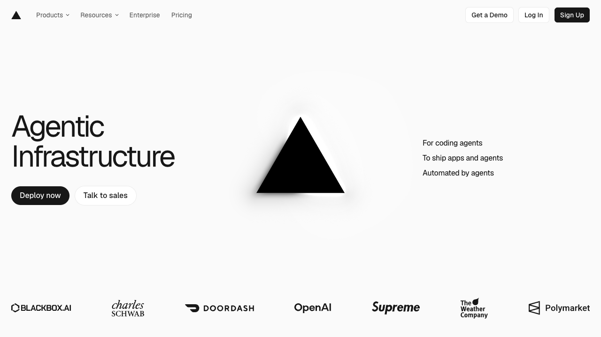

**官网**：https://vercel.com

**适合什么：** Next.js 项目、React/Vue 前端、带 Serverless Functions 的全栈应用、AI Chatbot（响应快的）

**怎么用：**
1. 用 GitHub 账号登录 Vercel
2. 点击 "Add New..." → "Project"
3. 选择你的 GitHub 仓库
4. Vercel 自动检测框架（Next.js/Vite/React 等），填好环境变量
5. 点 "Deploy"，等 1-2 分钟就上线了，自动给你一个 `xxx.vercel.app` 域名

**免费方案（Hobby 计划）：**
- 适合个人、非商业项目，包含自动 HTTPS 与 Git 预览部署
- 请求、函数、构建和其他资源有各自额度，超额行为以套餐为准
- 函数运行时长与运行模式、套餐和配置有关，不统一写成“免费只能运行 10 秒”

**关键限制：**
- 函数不是始终运行的服务器进程，不能直接承载常驻 Bot 或任意 WebSocket 服务端
- 可以配置定时触发，但触发频率与函数限制需要核对当前套餐
- AI 流式接口也要检查最大运行时长，模型 API 与平台资源分别计费

**结论**：适合前端和符合函数运行条件的 Next.js 项目；需要常驻进程时选择其他后端托管或 VPS。当前规则见 [Hobby 套餐](https://vercel.com/docs/plans/hobby)与 [函数时长说明](https://vercel.com/docs/functions/configuring-functions/duration)。

## 1.2 Cloudflare Pages — 静态资源托管与边缘函数

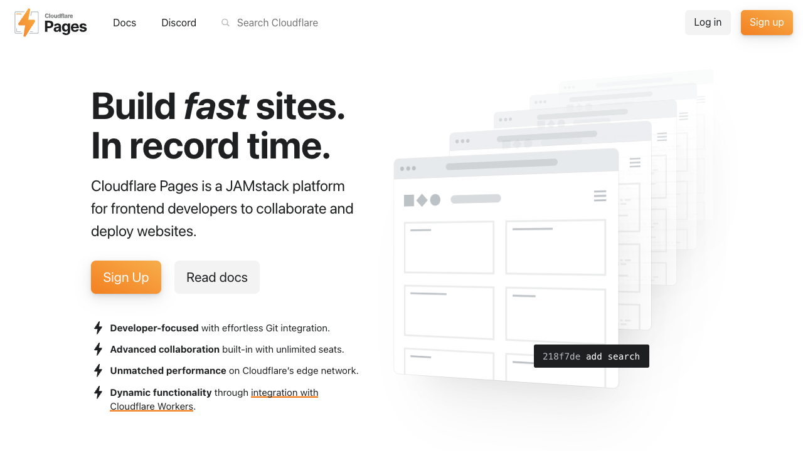

**官网**：https://pages.cloudflare.com

**适合什么：** 静态站点、Vite / VitePress 构建产物、与 Pages Functions 配合的小型网站

**免费方案：**
- 不调用函数的静态资源请求免费且不按请求次数设限
- 免费方案有每月构建次数、单文件大小等限制
- Pages Functions 使用 Workers 的计费与运行限制；Worker 免费请求额度不能当作无限后端算力
- 普通免费服务不等于接入 Cloudflare 中国大陆网络，访问效果应实测

**怎么用：**
1. 注册 Cloudflare 账号（免费）
2. 进入 Workers & Pages → Create → Pages → Connect to Git
3. 选择仓库，设置构建命令（Vite 是 `npm run build`，输出目录 `dist`）
4. 点 Save and Deploy

**配套的 Workers AI：** 可以按支持的模型和配额调用托管推理服务，免费额度以 [Workers AI 价格页](https://developers.cloudflare.com/workers-ai/platform/pricing/)为准。不同模型的调用成本不同，不用固定的调用次数估算所有模型。

**结论**：适合先发布静态网页，再按需增加轻量函数。参考 [Pages 限制](https://developers.cloudflare.com/pages/platform/limits/)与 [中国大陆网络说明](https://developers.cloudflare.com/china-network/)。

## 1.3 Netlify — 老牌静态托管，插件生态丰富

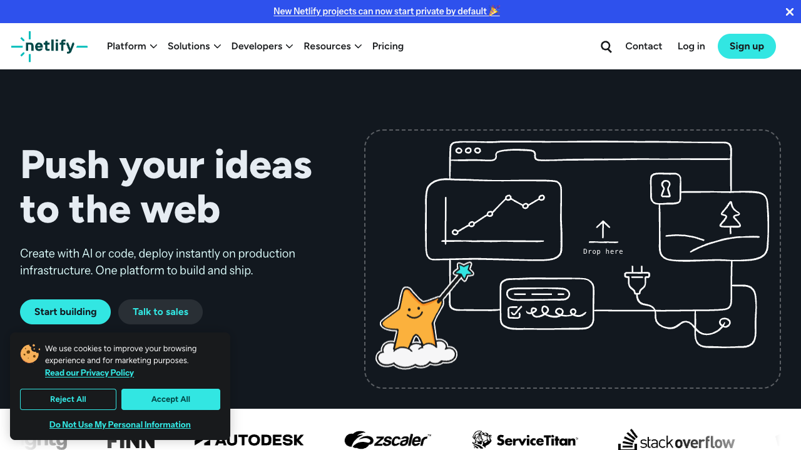

**官网**：https://www.netlify.com

**免费方案：** 当前 Free 套餐使用 credits 计算部署、请求、流量等用量，不沿用旧的固定带宽与构建分钟数。规则见 [Netlify 价格页](https://www.netlify.com/pricing/)。

**特点：** 插件市场非常丰富（表单处理、图片优化、A/B 测试等），支持分支预览，企业级功能多。适合需要更多内置功能的静态站项目。

**和 Vercel 的区别：** Netlify 更中立，不绑定特定框架；Vercel 对 Next.js 有深度优化。纯静态站选哪个都行。

## 1.4 Railway — 组合部署后端与数据库

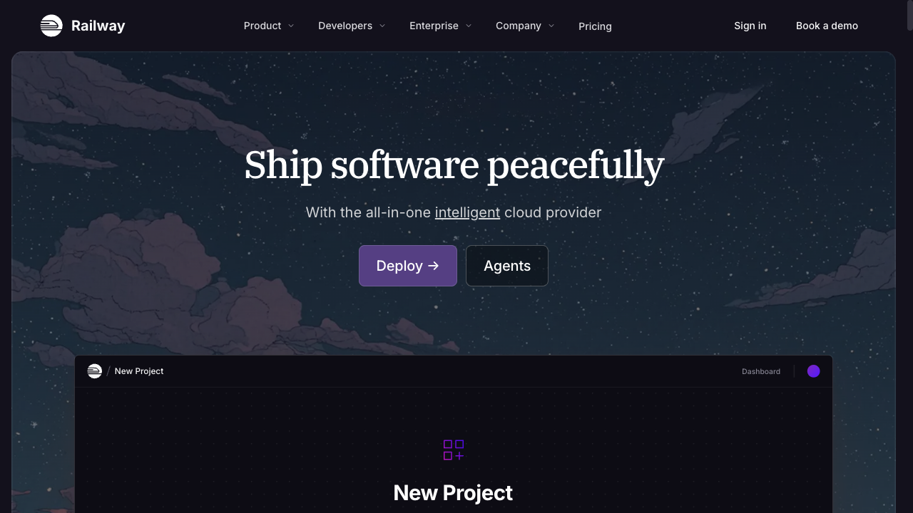

**官网**：https://railway.com

**适合什么：** 需要常驻运行的后端服务、Node.js/Python/Go API、Discord/Telegram Bot、需要数据库的全栈项目

**怎么用：**
1. GitHub 账号登录
2. New Project → Deploy from GitHub repo（或选模板）
3. Railway 自动检测你的项目类型，自动安装依赖、构建、启动
4. 可以一键添加 PostgreSQL/Redis/MySQL/MongoDB 数据库
5. 自动给域名，也可以绑定自定义域名

**定价：**
- 当前 Free 方案先提供 30 天、5 美元试用额度，之后每月提供 1 美元额度，资源与服务数量有上限
- Hobby 最低消费每月 5 美元，包含相应使用额度，超出部分另计
- 应用、数据库、磁盘与流量需要合并估算，不能把最低消费当成完整项目的固定总价

**结论**：适合需要组合多个服务、希望减少服务器配置工作的项目。在线行为和资源上限应按具体服务设置核对，规则见 [Railway 价格页](https://railway.com/pricing/)。

## 1.5 CloudBase — 静态网站与后端云托管

**官网**：https://cloudbase.net

**适合什么：** 已使用腾讯云生态的项目、需要托管网页或后端程序的应用

**特点：**
- 静态网站托管用于发布 HTML、CSS、JavaScript 和前端构建产物
- 云托管用于运行 Node.js、Python 等后端程序，支持仓库、代码包或镜像部署
- 可以结合腾讯云数据库、存储等服务，按项目需要分别配置
- 试用资格与可用额度依账户和环境而定，不作为长期免费的默认方案

**怎么用：** 我们已经在 [上一章](../zeabur-deployment/) 介绍 CloudBase 的使用方法。后端程序需要选择云托管，不能只上传到静态网站托管。具体部署方式见 [官方说明](https://docs.cloudbase.net/run/deploy/deploy/introduce)。

## 1.6 Render — 750 小时免费，但会休眠

**官网**：https://render.com

**适合什么：** 学习阶段、个人项目、不介意冷启动的小项目

**免费方案与限制：**
- 免费 Web Service 每个工作区每月共享 750 个实例小时，流量与构建另有额度
- 连续 15 分钟无入站流量会休眠，下一次请求唤醒可能需要约一分钟
- 免费实例没有持久化磁盘，不把本地文件或 SQLite 当作长期数据存储
- 免费 Postgres 创建 30 天后到期，不是长期免费数据库

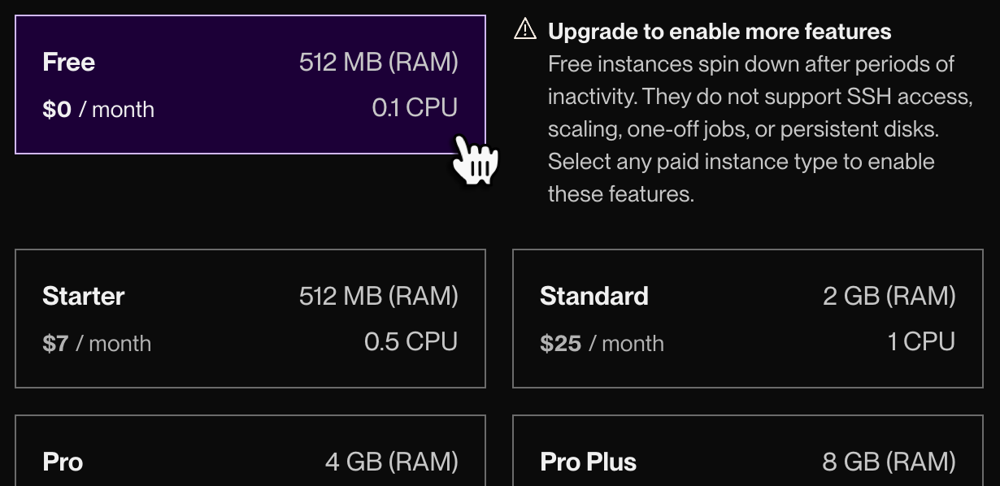

**结论**：适合课程练习和允许冷启动的演示；持续在线或长期数据存储需另选合适方案。配图与规则分别见 [官方首次部署指南](https://render.com/docs/your-first-deploy)和 [免费服务说明](https://render.com/docs/free)。

## 1.7 Fly.io — 容器部署与限时试用

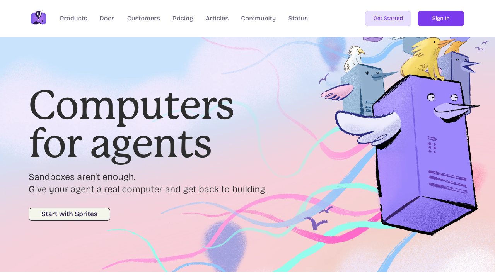

**官网**：https://fly.io

**适合什么：** 使用容器、需要选择部署地域、愿意使用命令行管理服务的项目

**免费试用：** 当前新账户试用为总计 2 小时虚拟机运行时间或 7 天访问期，以先到者为准。它不是长期免费、持续在线的容器资源；添加付款方式后，资源按规则计费。

**怎么用：**
1. 注册并检查账户的试用或计费状态
2. 安装 `flyctl`，在项目目录执行 `fly launch`
3. 核对镜像、地域、实例、磁盘和网络配置后部署
4. 用 `fly deploy` 更新，用 `fly logs` 查看日志

**结论**：可以用于容器化服务，但应核算实例、卷和网络等费用。当前规则见 [Fly.io 免费试用说明](https://docs.fly.io/about/free-trial)。

## 1.8 其他值得了解的免费/低成本平台

| 平台 | 类型 | 费用与限制核对入口 | 特点 |
|------|------|-------------------|------|
| **GitHub Pages** | 静态站 | [使用限制](https://docs.github.com/en/pages/getting-started-with-github-pages/github-pages-limits) | 适合博客、文档和项目展示，不运行独立后端 |
| **Hugging Face Spaces** | AI 演示 | [Spaces 概述](https://huggingface.co/docs/hub/spaces-overview) | 有免费 CPU 资源；GPU、休眠和存储按具体配置核对 |
| **Modal** | Python / GPU | [价格页](https://modal.com/pricing) | 按资源用量计费，赠送额度不代表所有项目免费 |
| **Replicate** | 模型推理 API | [价格页](https://replicate.com/pricing) | 调用托管模型，按模型与实际使用计费 |
| **Deno Deploy** | 应用托管 | [价格页](https://deno.com/deploy/pricing) | 根据当前运行环境和套餐检查兼容性 |
| **Koyeb** | 应用托管 | [价格页](https://www.koyeb.com/pricing) | 可用实例、地域和休眠规则需要核对 |
| **Railway 模板** | 多服务部署 | [模板入口](https://railway.com/deploy) | 模板创建的服务仍按资源计费 |
| **Supabase** | 数据库与后端服务 | [价格页](https://supabase.com/pricing) | Postgres、Auth、Storage 等分别有配额 |
| **Neon** | Serverless Postgres | [价格页](https://neon.com/pricing) | 按计算、存储等额度核对套餐 |
| **Upstash** | 托管 Redis 等 | [价格页](https://upstash.com/pricing) | 请求、存储和带宽分别计量 |

---

# 2. 国内云服务器详细购买指南

如果你需要完全控制服务器环境、跑自定义服务、或者 PaaS 满足不了需求，那就买一台自己的云服务器。这一节手把手教你怎么在国内三大云厂商买服务器。

## 2.1 选哪家？国内三大云厂商对比

### 腾讯云轻量应用服务器（推荐新手）

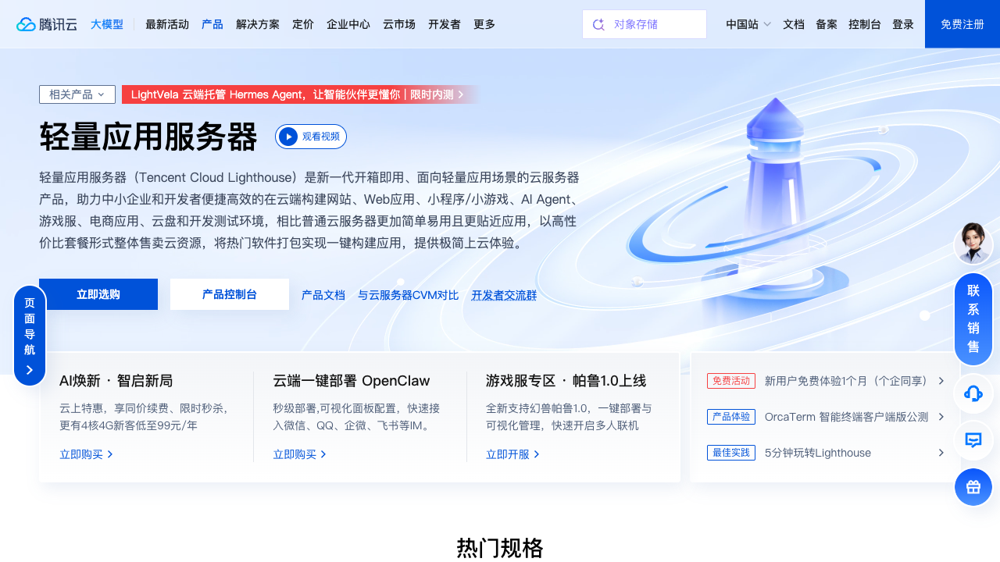

**官网**：https://cloud.tencent.com/product/lighthouse

**推荐理由：**
- **便于入门**：可在购买页比较 CPU、内存、磁盘、带宽和流量包，核对新购与续费价格
- **操作最简单**：控制台直观，一键应用镜像（WordPress、宝塔面板、Docker 等开箱即用）
- **套餐集中展示**：带宽峰值、月流量和超额费用需要一起查看，不能把带宽峰值理解为不限量流量
- **微信生态整合好**：部署小程序后端、公众号服务很方便

**怎么买：**
1. 注册腾讯云账号，完成实名认证
2. 打开轻量应用服务器购买页：https://cloud.tencent.com/product/lighthouse
3. 点击「立即选购」
4. 选择配置：
   - **地域**：离你的用户最近的（南方选广州、北方选北京、海外选香港/新加坡）
   - **镜像**：选「系统镜像」→ **Ubuntu 24.04 LTS**（本章示例环境；已有 22.04 LTS 可按官方支持情况使用）
   - **套餐**：按项目内存、磁盘、带宽和月流量选择，核对首购价、续费价和超额收费
   - **时长**：先确认项目适用，再按预算选择购买时长；活动优惠不一定适用于续费
5. 确认订单，付款
6. 购买成功后，进入「控制台」→「轻量应用服务器」就能看到你的服务器了
7. **重置密码**：点进服务器详情 → 重置密码（设一个强密码）
8. **配置防火墙**：在「防火墙」标签页添加规则：
   - TCP:80（HTTP）
   - TCP:443（HTTPS）
   - TCP:22（SSH）
   - 其他端口按需开放（比如 3000 调试用）

**学生优惠：** 如需学生方案，在 [官方校园活动页](https://cloud.tencent.com/act/campus)核对认证资格、可购资源与有效期，不将活动价格视为固定价格。

### 阿里云轻量应用服务器

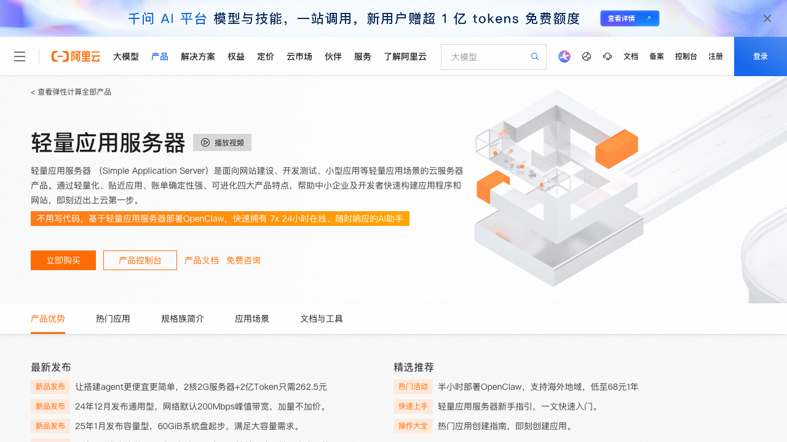

**官网**：https://www.aliyun.com/product/swas

**推荐理由：**
- **文档最丰富**：网上教程最多，遇到问题容易搜到答案
- **学生与新用户活动**：资格、优惠券和可用产品以活动页为准，不保证所有账户都能免费领机
- **稳定性好**：ESSD 云盘性能强，企业级稳定性
- **生态最全**：配套的 CDN、OSS、RDS、域名等服务最完善

**怎么买：**
1. 注册阿里云账号，完成实名认证
2. 学生用户可先检查当前教育优惠及资格：https://university.aliyun.com/
3. 打开轻量应用服务器：https://www.aliyun.com/product/swas
4. 点击「立即购买」
5. 选择配置：
   - **地域**：同腾讯云，选近的。中国香港/新加坡等地域按实际套餐核对带宽、流量和访问延迟
   - **镜像**：Ubuntu 24.04 LTS（或项目确认支持的 LTS 版本）
   - **套餐**：根据 CPU、内存、磁盘、带宽与流量选择，比较新购价和续费价
6. 付款后到控制台查看服务器
7. **重置密码**：实例详情 → 重置实例密码
8. **配置防火墙**：「安全组」/「防火墙」放行 22、80、443 端口

**学生活动：** 在 [阿里云学生入口](https://university.aliyun.com/)查看当期资格与资源，不把代金券等同于不限条件的免费服务器。

### 华为云耀云服务器 HECS

**官网**：https://www.huaweicloud.com/product/hecs.html

**推荐理由：**
- 企业级稳定性，安全防护能力强
- 价格、配置与学生优惠以 [华为云产品购买页](https://www.huaweicloud.com/product/hecs.html)为准
- 选择前核对 CPU 类型、性能约束、磁盘和公网计费方式
- 如需 ARM 架构，先确认所选地域、实例和镜像实际支持

**不足：** 文档和社区不如阿里云/腾讯云丰富，新手入门资料较少。

## 2.2 海外 VPS 选择（不想备案/面向海外用户）

如果用户主要在海外，或准备使用中国香港、境外资源部署，可以比较下面的平台。备案要求取决于服务部署位置与具体业务，并不是改用其他端口就可以绕过。

| 厂商 | 价格核对入口 | 需要一起检查 | 适合场景 |
|------|-------------|-------------|---------|
| **Vultr** | [产品与价格](https://www.vultr.com/pricing/) | 是否带 IPv4、流量额度、地域与磁盘 | 按需创建实例和练习部署 |
| **DigitalOcean** | [Droplet 价格](https://www.digitalocean.com/pricing/droplets) | 配置、带宽额度、备份和快照 | 结合官方文档学习 VPS |
| **Hetzner** | [Cloud 价格](https://www.hetzner.com/cloud/) | 地域、税费、IPv4 与流量 | 比较长期运行成本 |
| **AWS Lightsail** | [价格与试用](https://aws.amazon.com/lightsail/pricing/) | 账户资格、试用期限、IP 类型与流量 | 使用 AWS 生态的简单应用 |
| **RackNerd** | [产品入口](https://www.racknerd.com/) | 年付、退款、地域、备份和支持条件 | 非核心实验项目 |
| **雨云** | [产品入口](https://www.rainyun.com/) | 实际地域、配置、计费与访问效果 | 按实际网络测试后选择 |

**Vultr 购买流程（其他海外厂商类似）：**
1. 访问 https://www.vultr.com/ 注册账号（需要邮箱+信用卡/PayPal）
2. 点击 "Deploy Server"
3. 选择：
   - **系统镜像**：Ubuntu 24.04 LTS；实例类型、地域与系统镜像分别核对
   - **Server Size**：按项目实际内存和 CPU 选择；同时检查 IPv4、磁盘和流量费用
   - **Location**：按目标用户位置选择，并实测网络，不仅根据城市推断延迟
4. 不用加额外选项，点 "Deploy Now"
5. 等 1-2 分钟，服务器创建完成，在 Products 页面能看到 IP 和密码
6. 海外 VPS 也可能提供云防火墙或安全组；检查云端入站规则，再检查系统内 `ufw` 等防火墙

**访问效果：** 延迟取决于地域、运营商和线路，不能把固定毫秒数当作保证。用目标用户的网络测试页面与接口，再确定部署地域。

## 2.3 备案问题（国内服务器必须了解）

**什么是备案？** 在中国大陆资源上对外提供网站或 APP 服务时，需要按接入商与主管部门要求办理相应备案。它是网站和服务接入要求，不能理解成“只管 80/443，换个端口就不用备案”。

**选择地域时检查：**
- 中国大陆地域：在上线前核对接入商的备案条件、域名实名认证与所需材料
- 中国香港及境外地域：通常不按大陆接入资源办理 ICP 备案；仍按产品和业务的实际规则使用
- 处理时间受资料、地区和审核进度影响，不保证固定天数
- 个人与单位主体适用条件不同，具体要求查看接入商当期说明

腾讯云的 [备案资源条件](https://cloud.tencent.com/document/product/243/18908)与 [常见问题](https://cloud.tencent.com/document/faq/243)可以作为操作入口。普通 Cloudflare 免费服务不自动接入中国大陆网络，不能据此承诺“免备案且有大陆 CDN 加速”。

---

# 3. 连接服务器 & 基础环境配置

## 3.1 第一次 SSH 连接服务器

买好服务器后，你会拿到：
- **公网 IP 地址**（比如 `123.45.67.89`）
- **登录用户名**（Ubuntu 镜像默认是 `root` 或 `ubuntu`）
- **认证方式**（购买时设置的密码或 SSH 密钥，按镜像和云厂商说明确认）

**如果你用 macOS / Linux：** 直接打开终端，输入：

```bash
ssh root@你的服务器IP
# 例如：ssh root@123.45.67.89
```

**如果你用 Windows：** 推荐用 Windows Terminal + 内置 OpenSSH（Win10/11 自带），或使用 FinalShell（中文、图形化）、Xshell 等工具。

第一次连接会提示：

```
The authenticity of host '123.45.67.89 (123.45.67.89)' can't be established.
ED25519 key fingerprint is SHA256:xxxxxx.
Are you sure you want to continue connecting (yes/no/[fingerprint])?
```

先通过云控制台或可信渠道核对主机指纹，确认连接的是自己的服务器，再输入 `yes`。使用密码时输入密码，使用密钥时按密钥配置认证。看到类似提示符，说明登录成功：

```
Welcome to Ubuntu 24.04 LTS!
root@your-server:~#
```

**配置 SSH 密钥登录（推荐，免密码+更安全）：**

```bash
# 在你本地电脑执行（不是服务器上）
# 生成密钥（如果已经有就跳过）
ssh-keygen -t ed25519

# 把公钥传到服务器
ssh-copy-id root@你的服务器IP

# 用新终端验证密钥能正常登录，确认成功后再考虑关闭密码登录
ssh root@你的服务器IP
```

> 🎯 **AI 辅助提示**：如果你连不上服务器，直接把报错信息复制给 AI：「我 ssh root@xxx 连接不上，报错是 xxx，帮我排查」。AI 会从网络、安全组、防火墙、密钥权限等角度一步步帮你找原因。

## 3.2 配置安全组/防火墙（非常重要！）

**云厂商安全组（控制台操作）：** 购买服务器后，一定要在云厂商控制台的「安全组」/「防火墙」里放行端口：

| 端口 | 用途 | 建议 |
|------|------|------|
| **22** | SSH 登录 | 必开，建议限制为自己的 IP |
| **80** | HTTP 访问 | 必开 |
| **443** | HTTPS 访问 | 必开 |
| **实际应用端口** | 本地或临时调试 | 不批量放开端口段；通过 Nginx 代理时通常无需向公网开放 |
| **8080** | 常见备用端口 | 按需 |

**服务器内部防火墙（登录后执行）：**

```bash
# 安装 ufw
sudo apt install -y ufw

# 允许 SSH、HTTP、HTTPS
sudo ufw allow ssh
sudo ufw allow http
sudo ufw allow https

# 启用防火墙
sudo ufw enable

# 查看状态
sudo ufw status
```

> 安全组是云端的入站规则，ufw 是服务器内的防火墙。启用 ufw 前先确认实际 SSH 端口已放行，并保留当前会话，用另一个终端测试登录；Docker 发布端口还受 Docker 网络规则影响，不应只依赖 ufw 判断暴露范围。

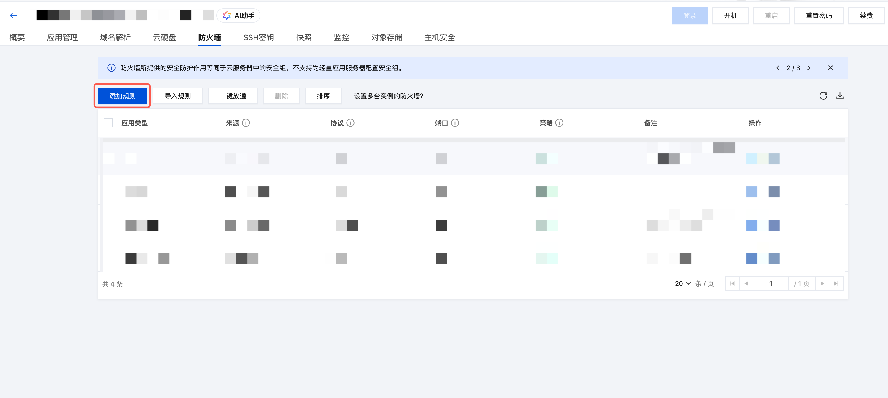

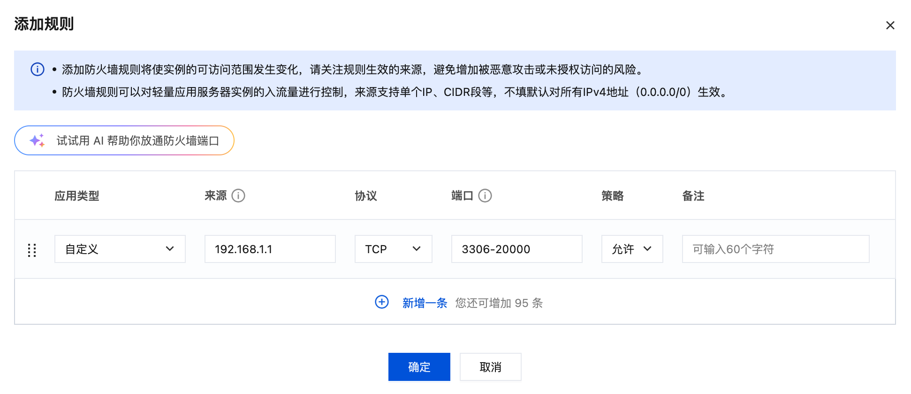

图片来源：[腾讯云轻量应用服务器管理防火墙](https://cloud.tencent.com/document/product/1207/44577)。图中的规则是官方操作示意，不是本项目的推荐端口清单；按上文仅放行实际需要的端口，并限制 SSH 来源。

## 3.3 初始化服务器环境

登录服务器后，可以把下面这段话复制给 AI 编程助手，让它按项目生成初始化命令：

> 「我刚买了一台 Ubuntu 24.04 LTS 云服务器，准备部署一个 [项目类型]。请区分本地操作、管理员操作和普通用户操作，完成基础工具、非 root 用户、SSH 密钥、Node.js、Nginx 与防火墙配置。需要 Docker 时按官方 Ubuntu 安装指南操作，并说明如何验证每一步。」

下面以 Ubuntu 24.04 LTS 为例。**第一段在服务器的管理员终端执行**，如果当前用户不是 root，则使用具备 sudo 权限的账户：

```bash
sudo apt update
sudo apt install -y ca-certificates curl git vim ufw build-essential nginx
sudo adduser yourname
sudo usermod -aG sudo yourname
sudo systemctl enable --now nginx
```

为 `yourname` 配置自己的 SSH 公钥，确认 `/home/yourname/.ssh` 权限为 `700`、`authorized_keys` 为 `600`，并且归该用户所有。保留原来的管理员会话，用本地另一个终端测试 `ssh yourname@服务器IP`，成功后再继续。

**后面的 Node.js 操作在 `yourname` 的服务器会话里执行**，不要在 root 的家目录安装后再假定普通用户也能使用：

```bash
curl -o- https://raw.githubusercontent.com/nvm-sh/nvm/v0.40.8/install.sh | bash
export NVM_DIR="$HOME/.nvm"
. "$NVM_DIR/nvm.sh"
nvm install 24
nvm alias default 24
node --version
npm --version
```

本章核对时 Node.js 24 是受支持的 LTS，Node.js 20 已进入 EOL。实际项目仍需检查 `engines`、锁文件和依赖兼容性，版本支持见 [Node.js 官方发布表](https://nodejs.org/en/about/previous-releases)，安装脚本见 [nvm 官方仓库](https://github.com/nvm-sh/nvm)。

浏览器访问 `http://服务器IP` 可以检查 Nginx 是否响应。如果准备使用 Docker Compose，按 [Docker 官方 Ubuntu 安装步骤](https://docs.docker.com/engine/install/ubuntu/)安装 Engine 与 Compose 插件，再验证：

```bash
sudo docker version
sudo docker compose version
```

可选择把普通用户加入 `docker` 组，但这相当于授予很高的主机权限；加入后要重新登录才能生效。后文示例默认使用 `sudo docker compose`，无需为练习额外放宽组权限。

---

# 4. 三种典型部署场景实操

环境配好之后，我们来看三种常见的部署方式。

## 4.1 场景一：部署纯前端静态站（Vite/React/Vue）

Vite 项目执行 `npm run build` 后通常会生成 `dist/`，其他工具应按实际输出目录操作。这里统一把发布文件放在服务器的 `/var/www/myapp/dist`，避免上传位置与 Nginx 的 `root` 不一致。

**先在服务器准备目录：**

```bash
sudo mkdir -p /var/www/myapp/dist
sudo chown -R yourname:yourname /var/www/myapp
```

**方式一：本地构建并上传。下面在本地项目目录执行：**

```bash
npm ci
npm run build
rsync -avz ./dist/ yourname@服务器IP:/var/www/myapp/dist/
```

`npm ci` 适用于有 `package-lock.json` 的项目，pnpm / Yarn 项目沿用各自的安装方式。`dist/` 末尾的斜杠表示传输目录内的文件。

**方式二：在服务器构建。下面以 `yourname` 用户执行：**

```bash
mkdir -p ~/apps
cd ~/apps
git clone https://github.com/你的用户名/你的仓库.git myapp
cd myapp
npm ci
npm run build
rsync -av ./dist/ /var/www/myapp/dist/
```

这两种方式任选其一。前者不要求服务器安装前端构建依赖，后者便于从仓库更新；不要在同一个练习里把两种目录结构混用。

**配置 Nginx：**

```bash
sudo vim /etc/nginx/sites-available/myapp
```

写入下面的配置，将域名占位符替换为自己的域名。尚未配置域名时，可以用实际公网 IP 测试：

```nginx
server {
    listen 80;
    server_name example.com www.example.com;

    root /var/www/myapp/dist;
    index index.html;

    location / {
        try_files $uri $uri/ /index.html;
    }

    location = /index.html {
        add_header Cache-Control "no-cache";
    }

    # 适合 Vite 默认生成的带内容哈希的构建资源。
    location /assets/ {
        try_files $uri =404;
        expires 1y;
        add_header Cache-Control "public, immutable";
    }
}
```

`try_files` 的回退适合有前端路由的单页应用。文档站或多页网站应按自己的路由结构配置，不统一回退到同一个首页。长期缓存只给带版本或哈希的构建资源，不能给所有同名图片和入口 HTML 都设置一年不可变缓存。

启用配置并检查：

```bash
sudo ln -sfn /etc/nginx/sites-available/myapp /etc/nginx/sites-enabled/myapp
sudo nginx -t
sudo systemctl reload nginx
curl -I -H 'Host: example.com' http://127.0.0.1
```

如果保留了 Ubuntu 的默认 Nginx 站点，通过 IP 访问可能仍显示欢迎页。先用上面的 Host 头确认配置命中，再通过已正确解析的域名访问；需要直接用 IP 时把它加入本例 `server_name`。最后测试首页、图片、脚本和页面刷新。`nginx -t` 只检查配置，不能代替实际访问测试。

## 4.2 场景二：部署 Node.js 后端服务

后端需要持续运行，关键是让它在后台不停止。

**用 PM2：** 下面在普通部署用户的服务器会话执行，启动文件以实际项目为准：

```bash
npm install -g pm2
cd /path/to/your/app
npm ci
npm run build  # 只有项目确实定义了 build 脚本时才执行
pm2 start dist/main.js --name myapp
pm2 startup
```

`dist/main.js` 只是一个编译后入口示例。纯 JavaScript 项目可能是 `server.js`，也可以按项目使用 `pm2 start npm --name myapp -- start`。

`pm2 startup` 会输出一条带环境路径的管理员命令。先核对并执行它，再执行 `pm2 save` 保存进程列表，不是运行一次 `pm2 startup && pm2 save` 就自动完成所有设置。更换 nvm 下的 Node.js 版本后，还需检查启动服务里的 Node 路径。参考 [PM2 开机启动说明](https://pm2.keymetrics.io/docs/usage/startup/)。

```bash
pm2 save
pm2 status
pm2 logs myapp
curl http://127.0.0.1:3000/health
```

最后一个命令使用本例的健康检查路径；现有项目要替换成实际存在的接口。通过同机 Nginx 代理的后端可以只监听 `127.0.0.1:3000`，无需把应用端口额外开放到公网。

**用 Nginx 反向代理：**

```nginx
server {
    listen 80;
    server_name api.yourdomain.com;

    location / {
        proxy_pass http://127.0.0.1:3000;
        proxy_http_version 1.1;
        proxy_set_header Host $host;
        proxy_set_header X-Real-IP $remote_addr;
        proxy_set_header X-Forwarded-For $proxy_add_x_forwarded_for;
        proxy_set_header X-Forwarded-Proto $scheme;
        proxy_read_timeout 120s;
        proxy_buffering off;
    }
}
```

将这个后端配置保存为独立的 `/etc/nginx/sites-available/myapp-api`，再用第 4.1 节的方式建立同名启用链接、运行 `sudo nginx -t` 并重新加载。每个站点的 `server_name` 应与实际域名一致，不能只把配置留在编辑器里。

普通 HTTP 接口可使用以上配置；WebSocket 服务还需要按应用要求添加 Upgrade 代理配置，不能直接假定这个最小示例已经支持。

## 4.3 场景三：Docker Compose 一键部署全栈

使用容器时，应用仍需有明确的构建与启动入口。下面继续以执行 `npm run build` 后生成 `dist/main.js` 的 Node.js 后端为例：应用需要监听 `0.0.0.0:3000`，并按需读取 `DATABASE_URL` 与 `REDIS_URL`。纯前端项目不照抄这个 Dockerfile。

先准备目录：

```text
project/
├── Dockerfile
├── .dockerignore
├── compose.yaml
├── nginx.conf
├── .env
├── package.json
├── package-lock.json
├── src/
└── frontend/dist/
```

`frontend/dist` 是已经构建好的前端文件；后端代码和依赖文件放在项目根目录。`.env` 保存本机秘密配置，不提交到 Git。

```dockerfile
# Dockerfile：本例是需要编译的 Node.js 后端。
FROM node:24-alpine
WORKDIR /app
COPY package*.json ./
RUN npm ci
COPY . .
RUN npm run build
ENV NODE_ENV=production
EXPOSE 3000
USER node
CMD ["node", "dist/main.js"]
```

创建 `.dockerignore`，避免把本机依赖、密钥和前端产物复制进后端镜像：

```text
node_modules
.git
.env
frontend/dist
```

在服务器的项目目录创建私有 `.env`，设置一个长随机字母数字密码，例如 `POSTGRES_PASSWORD=替换为自己的随机密码`。不要把这个占位符当作实际密码。连接串中的密码若含特殊字符，需要按 URL 规则编码；本例用字母数字密码简化练习。

```yaml
# compose.yaml
services:
  app:
    build: .
    environment:
      PORT: "3000"
      DATABASE_URL: postgresql://myapp:${POSTGRES_PASSWORD:?set POSTGRES_PASSWORD}@db:5432/myapp
      REDIS_URL: redis://redis:6379
    depends_on:
      db:
        condition: service_healthy
      redis:
        condition: service_healthy
    restart: unless-stopped

  db:
    image: postgres:16-alpine
    environment:
      POSTGRES_USER: myapp
      POSTGRES_PASSWORD: ${POSTGRES_PASSWORD:?set POSTGRES_PASSWORD}
      POSTGRES_DB: myapp
    volumes:
      - postgres_data:/var/lib/postgresql/data
    healthcheck:
      test: ["CMD-SHELL", "pg_isready -U myapp -d myapp"]
      interval: 5s
      timeout: 5s
      retries: 12
    restart: unless-stopped

  redis:
    image: redis:7-alpine
    healthcheck:
      test: ["CMD", "redis-cli", "ping"]
      interval: 5s
      timeout: 3s
      retries: 12
    restart: unless-stopped

  nginx:
    image: nginx:stable-alpine
    ports:
      - "80:80"
    volumes:
      - ./nginx.conf:/etc/nginx/conf.d/default.conf:ro
      - ./frontend/dist:/usr/share/nginx/html:ro
    depends_on:
      - app
    restart: unless-stopped

volumes:
  postgres_data:
```

数据库与 Redis 没有映射到宿主机公网端口，应用通过 Compose 内网访问它们。数据卷保存 PostgreSQL 数据，但数据卷不是备份；Redis 在本例中仅作为可重建缓存使用。

把下面内容保存为同一目录的 `nginx.conf`：

```nginx
server {
    listen 80;
    server_name _;
    root /usr/share/nginx/html;
    index index.html;

    location /api/ {
        proxy_pass http://app:3000;
        proxy_set_header Host $host;
        proxy_set_header X-Forwarded-For $proxy_add_x_forwarded_for;
        proxy_set_header X-Forwarded-Proto $scheme;
        proxy_read_timeout 120s;
        proxy_buffering off;
    }

    location / {
        try_files $uri $uri/ /index.html;
    }
}
```

这里的 `proxy_pass` 不带末尾斜杠，会保留 `/api/` 路径前缀，因此后端应提供 `/api/...` 接口；如果实际后端没有这个前缀，需要相应修改路由或代理规则。

先检查配置，再构建与启动。`config --quiet` 不会把展开后的数据库密码打印出来：

```bash
sudo docker compose config --quiet
sudo docker compose up -d --build
sudo docker compose ps
sudo docker compose logs --tail=50 app
curl -I http://127.0.0.1
```

同一台机器的宿主机 Nginx 如果已经占用 80 端口，这个容器就不能再次绑定 80。实际部署时选择“宿主机代理”或“容器代理”中的一种，不要把两套示例同时直接运行。

本例先提供 HTTP。配置 HTTPS 时需要真正添加证书、443 监听和证书挂载，不能只在 `ports` 里写上 `443:443` 就认为已经启用 HTTPS。

---

# 5. 域名 & HTTPS

## 5.1 买域名 & 解析

在阿里云、腾讯云、Namecheap、Cloudflare Registrar 等平台选购域名时，同时核对首年价格、续费价格和注册要求。域名价格不按固定金额保证。

在域名控制台添加 **A 记录**：

| 记录类型 | 主机记录 | 记录值 |
|---------|---------|--------|
| A | @ | 你的服务器 IP |
| A | www | 你的服务器 IP |
| A | api | 你的服务器 IP（后端 API） |

## 5.2 一键 HTTPS（Let's Encrypt 免费证书）

下面的方式适用于宿主机直接运行的 Nginx。先确认所有列出的域名都已经正确解析、相应站点能通过公网 HTTP 访问，且 80 / 443 端口可用。只有一个域名时，只保留相应的 `-d` 参数。

```bash
sudo apt install -y certbot python3-certbot-nginx
sudo certbot --nginx -d yourdomain.com -d www.yourdomain.com -d api.yourdomain.com
# 按当前交互提示选择需要的配置，不依赖固定的菜单序号
sudo certbot renew --dry-run  # 测试续期流程
systemctl list-timers --all | grep certbot
```

还需确认自动续期任务确实存在并能执行；证书签发成功不等于后续一定自动续期。容器 Nginx 需要对应的 ACME 客户端、共享验证目录与证书挂载，不能直接套用宿主机插件配置。参考 [Certbot 官方安装指引](https://certbot.eff.org/instructions)。

---

# 6. 云厂商常见服务功能全解析（不只是服务器！）

买了云服务器之后，你会发现云厂商控制台里有上百种产品，名字听起来都很专业（ECS、OSS、CDN、RDS、SLB…），新手往往不知道是干嘛的、什么时候该用。这一节我们把最常见的服务逐个讲清楚，**国内以阿里云/腾讯云为例，海外以 AWS 为例**，帮你建立云服务的「地图感」。

## 6.1 一张表搞懂：云服务全家福

先看全景。一个完整的 Web 应用在云上通常长这样：

```
用户先查询 DNS → 得到网站入口地址

用户 ──HTTPS──→ CDN（可选）──→ 负载均衡（可选）──→ 云服务器 / 容器（应用）
                                                        │
                                                        ├── 对象存储 OSS/COS/S3（文件）
                                                        ├── 云数据库 RDS（结构化数据）
                                                        └── Redis（缓存）

HTTPS 证书配置在实际接收 HTTPS 的 CDN、负载均衡或服务器上。
```

下面逐个解释每个服务是什么、什么时候用、怎么操作。

## 6.2 计算类：跑你代码的地方

### 云服务器 ECS / CVM / EC2

这就是我们前面一直在说的「VPS」「云服务器」。

| 厂商 | 产品名 | 说明 |
|------|--------|------|
| 阿里云 | ECS（弹性计算服务） | 最通用的云服务器，可以自由选配置、装系统 |
| 腾讯云 | CVM（云服务器）/ Lighthouse（轻量应用服务器） | CVM 更灵活，Lighthouse 更简单适合新手 |
| 华为云 | ECS / HECS（云耀） | HECS 类似轻量服务器 |
| AWS | EC2（Elastic Compute Cloud） | AWS 的虚拟服务器，类型极多（通用/计算优化/内存优化/GPU） |

**什么时候用：** 需要自己掌控运行环境、跑自定义服务、24小时在线的进程。

**怎么操作（以腾讯云轻量为例）：**
1. 进入「轻量应用服务器」控制台
2. 点「新建」选镜像（推荐 Ubuntu 24.04 LTS）、套餐、地域
3. 购买后在实例列表里看到公网 IP
4. 按镜像要求绑定 SSH 密钥，或设置初始登录密码；默认用户名以控制台提示为准
5. 点「防火墙」添加端口规则（22/80/443）
6. SSH 连接上去开始部署

### Serverless 函数计算 / Lambda

不用先购买一台常驻服务器，上传代码后按请求、计算时间等计费。预置并发、存储、网络和日志可能另行收费，不能把“没有请求”直接理解为“所有资源零费用”。

| 厂商 | 产品名 |
|------|--------|
| 阿里云 | 函数计算 FC |
| 腾讯云 | 云函数 SCF |
| AWS | Lambda |

**什么时候用：** 偶尔被触发的任务（比如 Webhook 处理、图片压缩、定时任务）、流量波动大的 API。不适合需要常驻的服务（比如 WebSocket Bot）。

### 容器服务 / EKS / ACK

如果你的项目用了 Docker，且规模变大需要管理多个容器，用 Kubernetes（K8s）编排。

| 厂商 | 产品名 |
|------|--------|
| 阿里云 | ACK（容器服务 Kubernetes 版） |
| 腾讯云 | TKE |
| AWS | EKS（Elastic Kubernetes Service）|

**什么时候用：** 多服务微服务架构、需要自动扩缩容、团队有运维能力。个人/小项目用不上，一台 VPS + Docker Compose 就够了。

## 6.3 存储类：放文件和数据的地方

### 对象存储 OSS / COS / S3 ⭐ 最常用

这是除了服务器之外最常用的服务，用来存放图片、视频、PDF、前端静态资源和备份。用户上传的文件放在对象存储里，应用重装或迁移时就不必跟着复制整块服务器磁盘；仍需根据数据重要性设置版本控制、保留策略和备份。

| 厂商 | 产品名 | 选用时关注什么 |
|------|--------|----------------|
| 阿里云 | [OSS](https://www.aliyun.com/product/oss) | 国内应用常用，核对地域、存储类型和外网流量费 |
| 腾讯云 | [COS](https://cloud.tencent.com/product/cos) | 适合腾讯云生态，核对请求、流量和资源包适用范围 |
| AWS | [S3](https://aws.amazon.com/s3/pricing/) | 地域和存储类型丰富，存储、请求、取回和传输分别计费 |
| Cloudflare | [R2](https://developers.cloudflare.com/r2/pricing/) | 兼容 S3 API，直接从 R2 出站不收流量费，但存储和操作仍可能收费 |

新用户赠送额度和试用资格会变，以账号控制台和以上官方页面为准。“有免费存储”不等于请求、下载和 CDN 都免费。

**它能做什么：**
- 存放用户上传的图片、头像和附件
- 分发构建好的静态资源；整站托管还要配置首页、路由回退、域名和 HTTPS
- 备份数据库导出文件
- 配合 CDN 分发公开资源
- 生成临时链接分享私有文件

下面的配图来自各平台官方文档，未登录个人账号创建资源。界面可能随版本调整，图中的名称、地域和套餐仅作演示；上传成功后，先确认文件仍是私有，再测试临时链接。

**怎么操作（以阿里云 OSS 为例）：**

1. 进入 OSS 控制台，点「创建 Bucket」，填写唯一名称并选择地域。与应用放在同一地域通常便于使用内网端点。
2. 入门先选「标准存储」，读写权限保留「私有」。不要为了显示一张图片就把整个存储桶公开。
3. 进入 Bucket →「文件管理」→「文件列表」，点「上传文件」，先用一张不含敏感信息的测试图片。
4. 上传后打开文件详情，用控制台生成的临时授权链接测试下载。私有文件的普通地址直接打开出现 403，通常是访问控制生效。
5. 接入应用时，由后端校验用户身份后生成短期签名链接；确实需要公开的静态资源再单独设计公共访问或 CDN 策略。

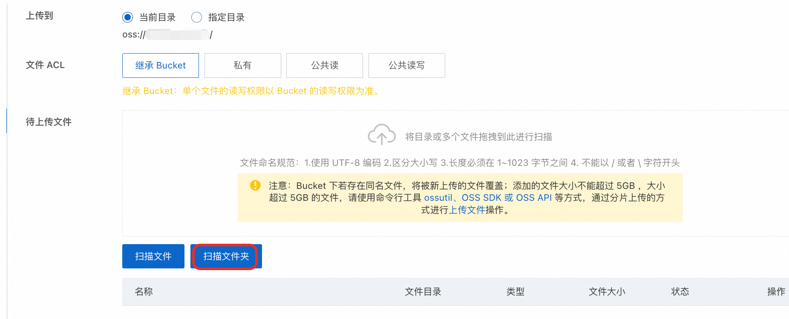

图片来源：[阿里云 OSS 简单上传文档](https://help.aliyun.com/zh/oss/user-guide/simple-upload)。创建存储桶和权限设置见 [OSS 控制台快速入门](https://help.aliyun.com/zh/oss/user-guide/console-quick-start)。

**用代码操作（Node.js 服务端示例）：**

```javascript
// 安装：npm install ali-oss
// 此示例使用 CommonJS（可保存为 upload.cjs）
const OSS = require('ali-oss');
const client = new OSS({
  region: process.env.OSS_REGION,
  accessKeyId: process.env.OSS_ACCESS_KEY_ID,
  accessKeySecret: process.env.OSS_ACCESS_KEY_SECRET,
  bucket: process.env.OSS_BUCKET,
  secure: true
});

async function uploadFile(localPath, objectKey) {
  await client.put(objectKey, localPath);
  // 私有对象返回短期下载链接，而不是假定 result.url 可公开访问
  return client.signatureUrl(objectKey, { expires: 300 });
}
```

环境变量放在服务器的密钥配置中；使用仅能访问目标 Bucket 和目录的 RAM 身份，不使用主账号 AccessKey。生产环境也可以改用实例角色或临时凭证。不要把密钥写进前端、Git 或 AI 对话；签名链接本身也应按临时凭证保护。参考 [ali-oss 官方 SDK](https://github.com/ali-sdk/ali-oss)。

**腾讯云 COS 操作：**

1. 打开 COS 控制台 →「存储桶列表」→「创建存储桶」，选择地域，填写名称。完整名称包含账号的 APPID 后缀。
2. 访问权限选择「私有读写」，再按实际需要设置日志、版本控制等功能，留意额外费用。
3. 进入「文件列表」→「上传文件」，上传测试图片，核对路径和大小。
4. 在文件详情中获取带签名的临时链接测试访问。应用通过后端生成链接，或用临时密钥限制前端上传范围。

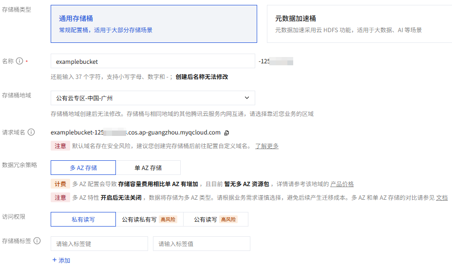

图片来源：[腾讯云 COS 创建存储桶](https://cloud.tencent.com/document/product/436/14106)。

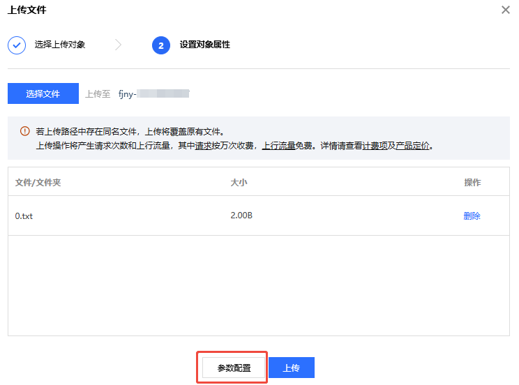

图片来源：[腾讯云 COS 上传对象](https://cloud.tencent.com/document/product/436/14113)。

**AWS S3 操作：**

1. AWS 控制台搜索 S3 →「Create bucket」，选择通用存储桶、唯一名称和区域。

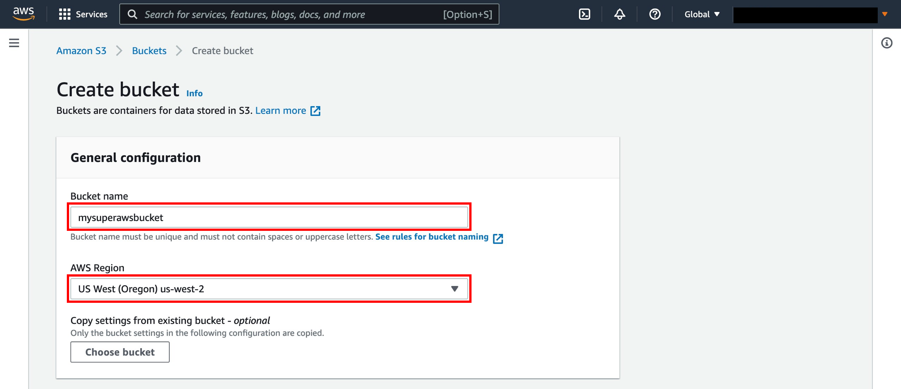

2. 保留「ACLs disabled」和「Block all public access」默认设置。后端使用 IAM 角色或受限身份访问，不需要为上传文件关闭公共访问拦截。

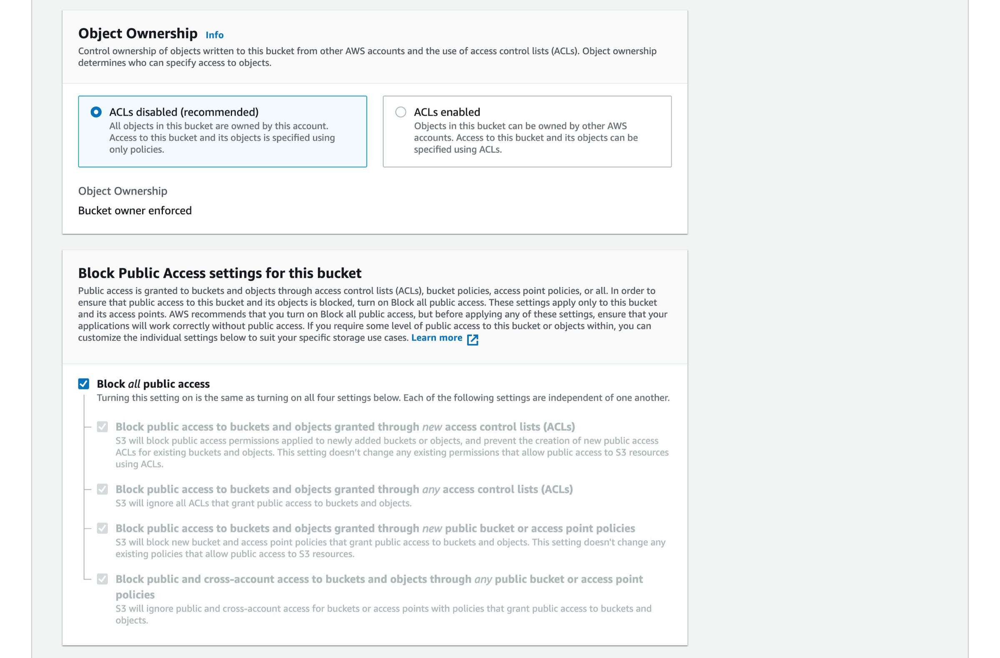

3. 创建后进入「Objects」→「Upload」→「Add files」，上传一张测试图片并等待成功。

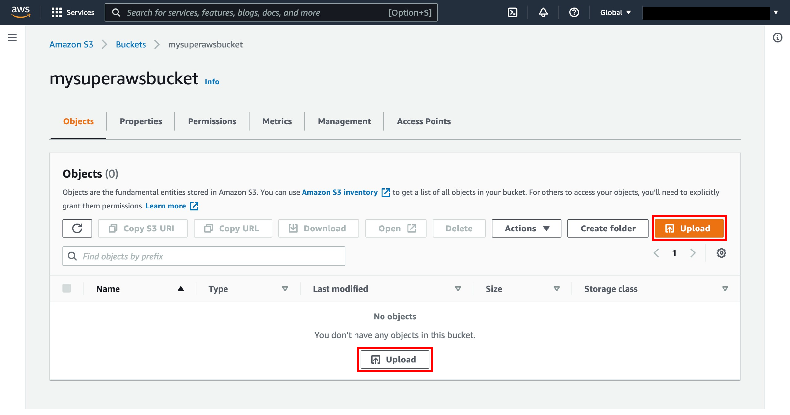

4. 回到对象列表，选择文件，在对象操作中生成预签名 URL（控制台可能显示「Share with a presigned URL」），先设置较短有效期，再在未登录的浏览器窗口测试。普通对象 URL 不会因为上传成功就自动公开。

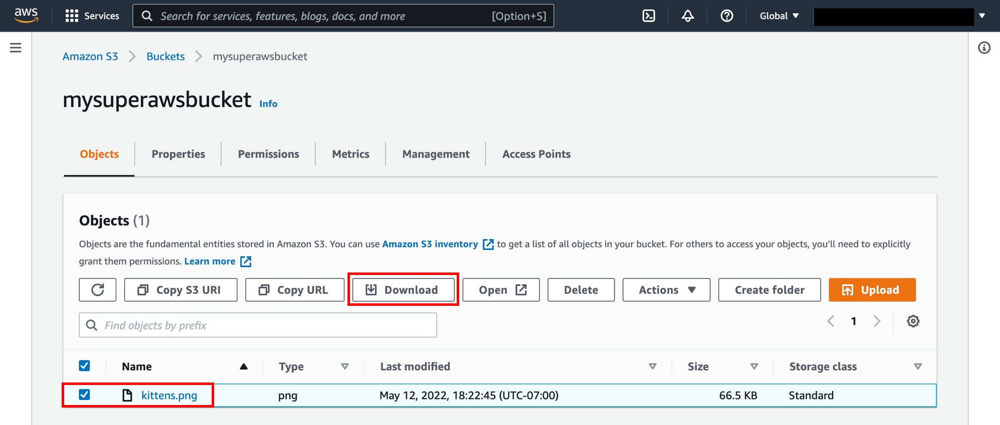

以上四张图片来源：[AWS S3 官方上传教程](https://docs.aws.amazon.com/hands-on/latest/backup-files-to-amazon-s3/backup-files-to-amazon-s3.html)；临时访问步骤见 [分享预签名 URL](https://docs.aws.amazon.com/AmazonS3/latest/userguide/ShareObjectPreSignedURL.html)。代码接入使用 AWS SDK for JavaScript v3，例如 `@aws-sdk/client-s3` 和 `@aws-sdk/s3-request-presigner`，凭证由服务端角色或凭证链提供。

**Cloudflare R2 操作：**

1. Cloudflare 控制台进入 R2，按账号提示开通服务并创建 Bucket，先确认当前免费额度、计费方式和预算。
2. 在 Bucket 的对象页面上传测试文件。保持私有，通过 S3 兼容 API 和预签名 URL 验证读取。
3. 接入现有 S3 客户端时，除了 Bucket 和凭证，还要把 endpoint 改成账号对应的 R2 地址；它不是 AWS S3 的默认端点。
4. 需要公开分发时再配置自定义域名；`r2.dev` 开发地址有速率限制，不适合作为生产分发入口。

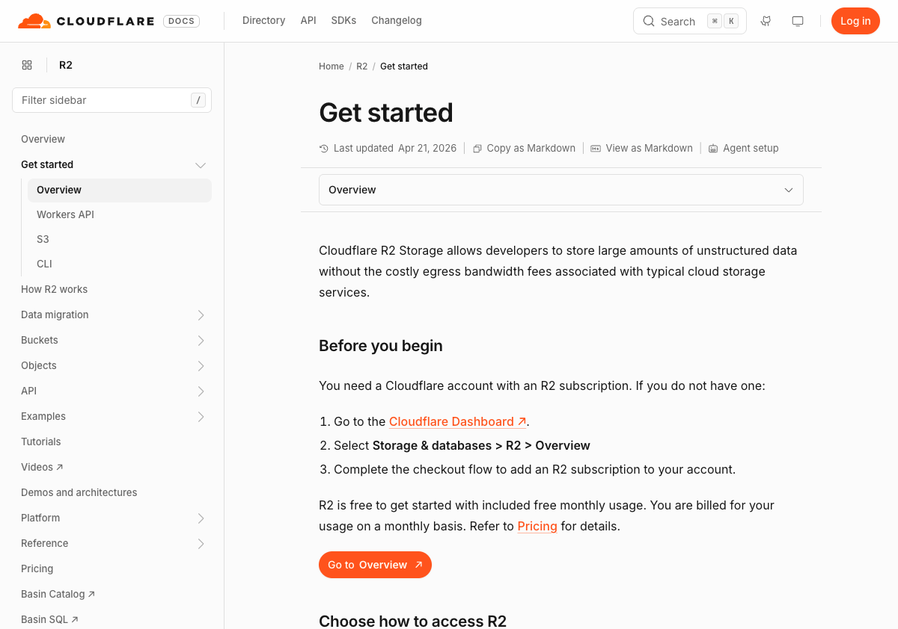

截图为官方指南页面，非个人账号控制台。来源：[R2 Get started](https://developers.cloudflare.com/r2/get-started/)；公共域名说明见 [Public buckets](https://developers.cloudflare.com/r2/buckets/public-buckets/)。

**配合 CDN 加速：** 对公开图片，可为 Bucket 配置自定义域名和 CDN。私有源站还需要授权回源和访问控制，不能简单改成公共读。是否省钱取决于命中率、回源流量、CDN 流量与请求费，应结合账单核对。

### 云硬盘 / 云盘 / EBS

挂载在云服务器上的块存储（类似电脑的硬盘）。服务器自带的系统盘通常 40-60GB，不够用时你可以额外买「数据盘」挂载上去。

- 阿里云：云盘（高效云盘/ESSD/SSD）
- 腾讯云：云硬盘 CBS
- AWS：EBS（Elastic Block Store）

**什么时候用：** 服务器磁盘不够、需要额外存储空间、需要独立管理数据。创建时要核对“随实例释放 / Delete on termination”等选项；删除服务器后是否保留云盘取决于配置，快照和备份也要另外安排。

### 文件存储 / NAS / EFS

多台服务器可以同时挂载的共享文件存储。适合多台 Web 服务器共享同一份上传文件。

- 阿里云：NAS（网络附加存储）
- 腾讯云：CFS
- AWS：EFS（Elastic File System）

个人小项目一般用不上，单台服务器 + OSS 足够。

## 6.4 数据库类：存结构化数据

### 云数据库 RDS / Cloud Database ⭐ 常用

前面的 Docker Compose 把 PostgreSQL 放在同一台 VPS，适合学习和小规模项目，但需要自行维护备份、恢复和资源隔离。有重要用户数据、可用性要求较高时，可以考虑托管数据库；自动备份、保留时间、高可用和扩容能力仍要按所选规格逐项配置。

| 厂商 | 产品名 | 选用时关注什么 |
|------|--------|----------------|
| 阿里云 | RDS | 按 MySQL、PostgreSQL 等引擎选择版本、规格和备份策略 |
| 腾讯云 | 云数据库 MySQL / PostgreSQL、TDSQL-C | 产品与兼容引擎对应，不能假定一个实例支持所有引擎 |
| AWS | RDS / Aurora | 核对引擎、区域、实例、存储、备份和账号优惠资格 |

**什么时候用：** 生产环境的数据库（特别是有用户数据、不能丢数据的场景）。

**怎么操作（以阿里云 RDS 为例）：**
1. RDS 控制台 → 创建实例
2. 选择与项目驱动和迁移脚本匹配的数据库引擎、受支持版本、规格和存储空间
3. 优先让数据库与应用位于同地域、可互通的 VPC，使用内网连接地址。白名单或安全组只允许应用的地址或安全组访问，不开放给所有公网 IP
4. 创建数据库账号和密码
5. 在「数据库管理」里创建数据库名
6. 拿到连接地址（类似 `rm-xxxxx.mysql.rds.aliyuncs.com:3306`）
7. 修改服务端的 `DATABASE_URL`，按厂商要求配置 TLS，再运行连接测试和数据库迁移。不要把连接串发到浏览器

AWS RDS 的流程类似：选引擎、规格和网络，再设置应用的连接权限。下图是官方文档中的 MySQL 创建界面，图中 Free tier 选项不代表所有新账号或当前规格都免费；以实际创建页面的资格和费用预估为准。

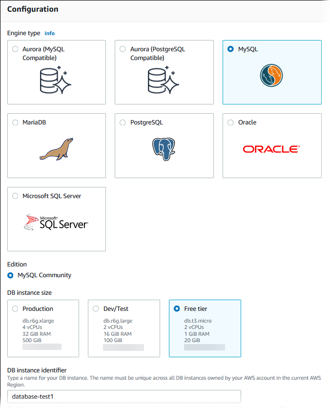

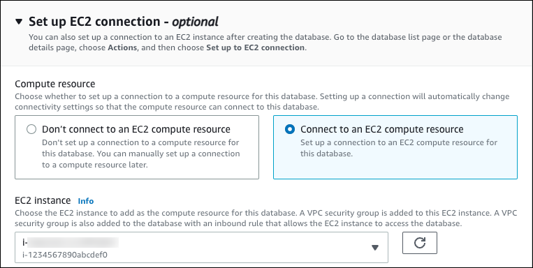

图片来源：[AWS RDS 创建并连接 MySQL 实例](https://docs.aws.amazon.com/AmazonRDS/latest/UserGuide/CHAP_GettingStarted.CreatingConnecting.MySQL.html)。私网连接还要核对 VPC、子网、路由和安全组，实例显示“可用”并不代表应用一定能连上。

> 💡 **vibecoding 提示：** 告诉 AI 数据库类型、版本和环境变量名称，让它生成连接代码、连接测试与迁移脚本；真实密码通过服务器密钥配置注入。

### 缓存 Redis / ElastiCache

内存数据库，用来缓存热点数据（减少数据库查询）、存 Session/Token、做消息队列、排行榜等。

- 阿里云：云数据库 Redis 版
- 腾讯云：云数据库 Redis
- AWS：ElastiCache for Redis

入门可以自行安装 Redis 或使用前面的容器示例。只允许应用通过内网或本机连接，不把 6379 直接暴露到公网；使用认证并按数据用途配置持久化。托管 Redis 可以减少维护工作，高可用能力和费用仍取决于套餐。把 Redis 用作任务队列时，还需要确认任务确认、重试和持久化机制，不能仅凭“用了 Redis”就保证任务不丢。

## 6.5 网络类：让用户访问更快更安全

### CDN（内容分发网络）⭐ 常用

把你的静态资源（图片、CSS、JS、视频）缓存到全球/全国的边缘节点，用户访问时从最近的节点拿，速度飞快。

- 阿里云：CDN / DCDN（全站加速）
- 腾讯云：CDN / EdgeOne（边缘安全加速）
- AWS：CloudFront

**什么时候用：**
- 网站有图片/视频等大文件
- 用户分布在全国各地/全球各地
- 想减少服务器带宽压力（CDN 帮你扛流量）
- 前面提到的 Cloudflare Pages 本质上就是 CDN + 静态托管

**怎么配置（以腾讯云 CDN 为例）：**
1. CDN 控制台 → 添加域名 → 填入你的域名（比如 `static.yourdomain.com`）
2. 源站类型选「COS源」或「自有源」（填你的服务器 IP）
3. 按控制台提示配置源站 Host、缓存规则及 HTTPS；私有 COS 还要授权 CDN 回源，等待配置生效
4. 去域名解析控制台，给 `static.yourdomain.com` 添加 CNAME 记录，指向 CDN 分配给你的 CNAME 地址
5. 用真实存在的测试文件验证 HTTPS、响应状态和缓存命中。不要缓存带用户隐私的接口响应；配置流量告警并检查实际费用。

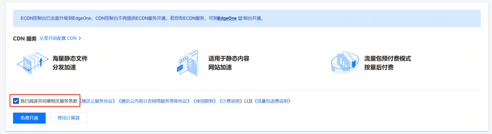

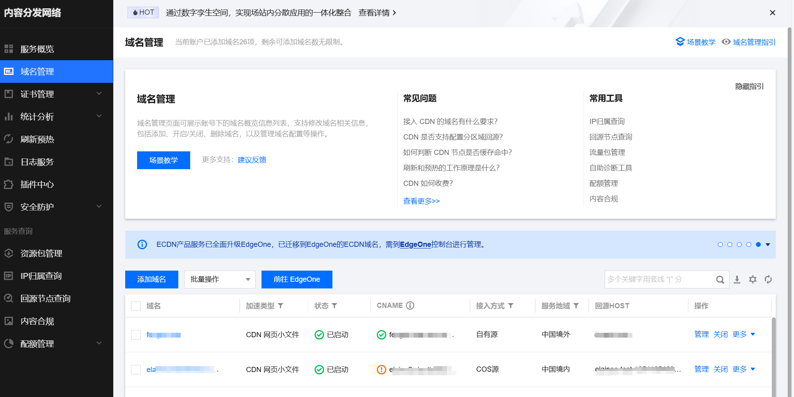

图片来源：[腾讯云 CDN 域名接入官方文档](https://cloud.tencent.com/document/product/228/3149)。DNS 已指向 CDN 只是其中一步，还需确认源站可达、证书匹配和缓存规则正确。

### 负载均衡 SLB / CLB / ALB / ELB

当你有多台后端服务器时，负载均衡器把流量均匀分发到各台服务器上，还能自动踢掉挂掉的服务器。

- 阿里云：SLB（服务器负载均衡）/ ALB（应用型）
- 腾讯云：CLB（负载均衡）
- AWS：ELB（Elastic Load Balancing：ALB/NLB/Gateway LB）

个人项目只有一台服务器时用不上，用户多了、需要多台服务器时再考虑。

### DNS 域名解析 / Cloud DNS

把域名翻译成 IP 地址的服务。买域名的地方通常自带免费 DNS 解析，但也可以换成更专业的。

- 阿里云：云解析 DNS（万网域名自带）
- 腾讯云：DNSPod（腾讯云旗下）
- AWS：Route 53
- 第三方：Cloudflare DNS（提供免费方案，实际解析与访问表现需按用户网络验证）

**怎么操作：** 在域名控制台添加解析记录：

| 记录类型 | 作用 | 示例 |
|---------|------|------|
| **A 记录** | 域名 → IPv4 地址 | `@ → 123.45.67.89` |
| **AAAA 记录** | 域名 → IPv6 地址 | `@ → 2400:xxxx::` |
| **CNAME 记录** | 域名 → 另一个域名（常用于 CDN） | `static → static.cdn.com` |
| **MX 记录** | 邮件服务器（用企业邮箱需要配） | - |
| **TXT 记录** | 任意文本（验证域名所有权、配置 SPF/DKIM 等） | - |

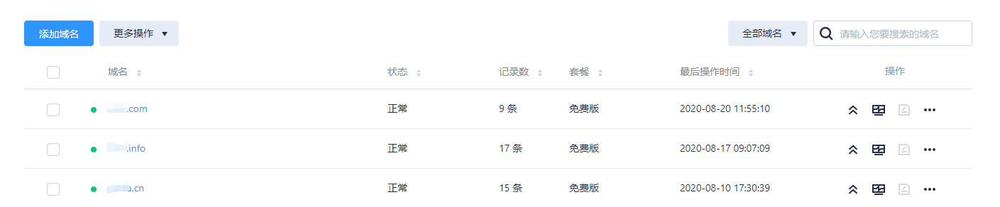

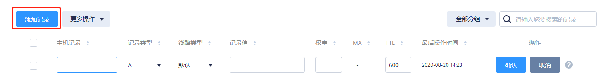

图片来源：[DNSPod 添加 A 记录](https://docs.dnspod.cn/dns/help-a/)。先确认域名实际使用 DNSPod 的权威 DNS；只在未生效的平台添加记录不会改变解析。记录值替换为自己的公网 IP，图中的地址不可直接照抄。

### SSL 证书服务

HTTPS 需要的 SSL 证书。

- 阿里云/腾讯云：有免费或付费证书产品，资格、域名数量、有效期与续期方式以当前产品规则为准。
- AWS：ACM 用于支持的 AWS 集成服务时有免费公有证书方案；可导出公有证书、私有证书等另有费用，不能把所有 ACM 证书都当作免费且可直接装进 VPS。
- 通用免费方案：Certbot + Let's Encrypt，需要验证域名、安装证书并维护自动续期。

前面第 5 章适用于宿主机 Nginx。证书有效期可能调整，按实际到期时间和续期任务检查。参考 [ACM 官方计费](https://aws.amazon.com/certificate-manager/pricing/) 和 [Let's Encrypt 证书说明](https://letsencrypt.org/certificates/)。

### VPC（私有网络）/ VPC

VPC 是云上的隔离网络。创建服务器和数据库时，需要核对地域、VPC、子网和安全组：即使两个资源在同一家云，也不代表能直接通过内网通信。

应用服务器可以通过公网入口提供 HTTPS，数据库通常放在受限的私网。只有确实需要出站访问的私有子网才考虑 NAT 网关，并核对其费用。

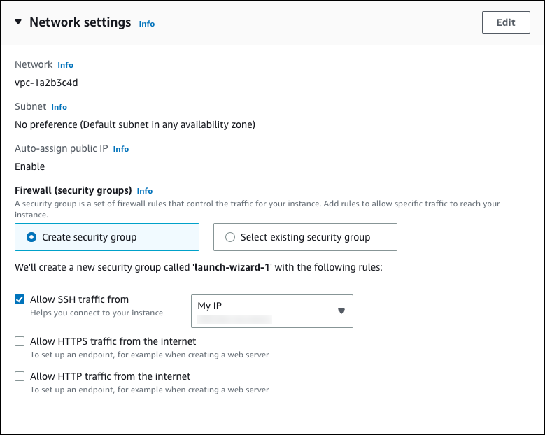

图片来源：[AWS RDS 与 EC2 连接教程](https://docs.aws.amazon.com/AmazonRDS/latest/UserGuide/CHAP_GettingStarted.CreatingConnecting.MySQL.html)。图中 SSH 来源选 My IP，体现的是管理端口按来源限制；Web 服务的 80/443 则按实际访问需求另设规则。

## 6.6 其他常用服务

### 域名注册 / Domain

买域名的地方。
- 国内：阿里云万网、腾讯云（DNSPod）、华为云
- 海外：Namecheap、Cloudflare Registrar、GoDaddy、Squarespace Domains
- 建议：核对域名实名与备案要求、后缀支持、续费价格、隐私保护和 DNS 限制，再选注册商

### 邮件服务 / SES

不要在服务器上自己搭邮件服务器（大概率被当成垃圾邮件）。用专业的邮件发送服务：
- 国内：阿里云邮件推送、腾讯云 SES
- 海外：AWS SES、SendGrid、Mailgun、Resend
- 用途：注册验证邮件、通知邮件、营销邮件

### 短信服务 / SMS

发送验证码短信、通知短信：
- 国内：阿里云短信服务、腾讯云短信
- 海外：AWS SNS、Twilio
- 国内短信的签名、模板和主体资质要求以运营商及服务商当前审核规则为准。个人项目若不满足条件，可以先用邮件验证码。

### 监控/日志 / CloudWatch

监控服务器的 CPU/内存/磁盘使用率，查看应用日志，设置告警（CPU 太高、服务挂了就通知你）：
- 阿里云：云监控、SLS（日志服务）
- 腾讯云：云监控、CLS（日志服务）
- AWS：CloudWatch

AWS EC2 的基础指标与操作系统内存、磁盘使用率是两回事：后两者通常需要安装 CloudWatch Agent 或自行上报，应用日志也需要配置采集。指标、日志保存和告警可能另行收费。

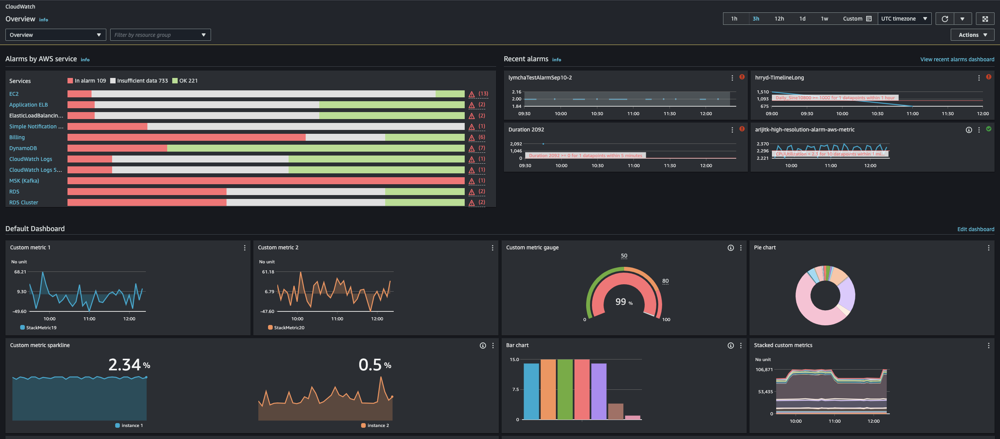

图片来源：[CloudWatch Getting started](https://docs.aws.amazon.com/AmazonCloudWatch/latest/monitoring/GettingStarted.html)。内存、磁盘和日志采集见 [CloudWatch Agent](https://docs.aws.amazon.com/AmazonCloudWatch/latest/monitoring/Install-CloudWatch-Agent.html)。

入门阶段可以用 PM2 看进程状态，再用 Uptime Kuma 从另一台机器检查站点可用性。若监控与应用在同一台 VPS，整台机器宕机时监控也会停止，不能据此确认站点仍然正常。

### 对象存储的进阶用法：图片处理/视频转码

云厂商的 OSS/S3 通常还附带媒体处理能力：
- 阿里云 OSS：图片处理（缩略图/水印/格式转换）、视频转码（需配合 MPS）
- 腾讯云 COS：数据万象 CI（图片处理/内容审核/人脸识别）
- AWS S3：配合 Lambda 自动生成缩略图

**示例**：你上传了一张 5MB 的原图 `photo.jpg`，在支持该处理方式的 OSS 对象地址后加参数 `?x-oss-process=image/resize,w_300`，可以请求 300px 宽的缩略图。私有对象还需要把处理参数纳入签名；图片处理可能单独计费，这个参数也不能直接用于 COS 或 S3。

## 6.7 国内 vs 海外：两套生态对照速查

做项目时经常需要在国内云和海外云之间对照，这个表帮你快速找到对应服务：

| 功能类别 | 阿里云 | 腾讯云 | AWS | 免费/低价替代 |
|---------|--------|--------|-----|-------------|
| 云服务器 | ECS | CVM / Lighthouse | EC2 | Vultr / DigitalOcean / Hetzner |
| 对象存储 | OSS | COS | S3 | Cloudflare R2（免出站流量费）|
| 关系数据库 | RDS | 云数据库 | RDS | Supabase / Neon（核对各自额度） |
| 缓存 Redis | 云 Redis | 云 Redis | ElastiCache | Upstash（Serverless Redis）|
| CDN | CDN | CDN / EdgeOne | CloudFront | Cloudflare CDN（免费）|
| 负载均衡 | SLB/ALB | CLB | ELB | Nginx 自建 / Caddy |
| Serverless | 函数计算 FC | 云函数 SCF | Lambda | Cloudflare Workers |
| 容器/K8s | ACK | TKE | EKS | 小项目可改用 VPS + Compose；Fly.io / Railway 提供容器托管，但不是同等 K8s 服务 |
| DNS 解析 | 云解析 | DNSPod | Route 53 | Cloudflare DNS（免费）|
| SSL 证书 | 免费/付费证书 | 免费/付费证书 | ACM（区分集成、导出与私有证书）| Let's Encrypt |
| 邮件推送 | 邮件推送 | SES | SES | Resend / SendGrid 免费额度 |
| 短信服务 | 短信服务 | 短信 | SNS | Twilio |
| 监控 | 云监控 | 云监控 | CloudWatch | Uptime Kuma（自建开源）|
| AI 模型/API | 通义千问、百炼 | 混元、TI平台 | Bedrock | OpenAI API / Anthropic API |
| 域名注册 | 万网 | DNSPod | Route 53 | Namecheap / Cloudflare |

## 6.8 新手常见疑问

**Q：我应该把所有服务都用云厂商的，还是都在 VPS 上自己搭？**

**个人项目/学习阶段：** VPS 自己搭就行（Docker Compose 一把梭），省钱且能学到东西。
**面向用户的生产项目：** 数据库和对象存储可以优先考虑托管服务（仍需配置备份并验证恢复），应用层还是可以跑在 VPS 上。
**预算充足/团队项目：** 尽量用云托管服务（RDS/Redis/OSS），把精力放在写业务代码上而不是运维上。

**Q：AWS 免费套餐怎么用？**

AWS 当前新账号免费计划与旧版“12 个月免费套餐”不同。新账号可获得初始 100 美元额度，并通过指定活动再获得额度，总计最高 200 美元；免费计划最长 6 个月，也可能在额度用完时提前结束。账号创建时间和计划类型会影响规则，不能直接照搬 EC2/RDS 每月 750 小时等旧表格。

开通前核对资源是否支持当前免费计划、剩余额度和到期处理方式。升级为付费计划后，超出优惠范围的资源会按标准费率计费；清理实验资源时也要检查磁盘、快照、数据库、IP 和存储桶是否仍保留。设置预算与告警，但不要把预算告警当成自动停止计费的开关。参考 [AWS 当前免费计划](https://aws.amazon.com/free/) 和 [免费套餐 FAQ](https://docs.aws.amazon.com/awsaccountbilling/latest/aboutv2/free-tier-FAQ.html)。

**Q：国内云和海外云怎么选？**

- 用户在国内 → 用国内云（阿里云/腾讯云）+ 备案，访问速度快且合规
- 用户在海外 → 用 AWS/Vultr/Fly.io/Cloudflare 等海外服务
- 两边都有用户 → 先从主要用户所在地域部署，测量不同网络表现；确需多地域时再设计 CDN、DNS 分流和数据一致性
- 选香港或其他海外节点 → 仍要测试国内不同运营商的访问表现，不能保证 Cloudflare Pages 或海外 VPS 在所有网络都稳定

---

# 7. AI Agent 专用部署平台

如果你部署的是 AI Agent（不只是普通 Web 应用），有些平台专门为 AI 工作负载设计：

## 7.1 Modal — Python AI/ML 的 Serverless GPU

**官网**：https://modal.com

**适合：** 需要 GPU 推理、定时任务、批量数据处理的 Python AI 项目

**特点：**
- 用 Python 装饰器定义函数，`modal deploy` 一键部署
- 按计算资源与使用时间计费；冷启动还受镜像、依赖和模型加载时间影响
- 内置定时任务、密钥管理、共享存储
- 当前 Starter 计划每月提供 $30 计算额度；是否够用取决于 GPU、运行时长与并发，见 [Modal 官方定价](https://modal.com/pricing)
- 缺点：只支持 Python

```python
# 保存为 agent.py：先验证远程函数调用，不申请 GPU
import modal

app = modal.App("my-ai-agent")

@app.function(timeout=300)
def run_agent(prompt: str):
    # 替换为实际模型逻辑前，先用回显检查部署链路
    return {"received": prompt}

@app.local_entrypoint()
def main():
    print(run_agent.remote("hello"))
```

安装 `modal` 并完成账号认证后，运行 `modal run agent.py` 测试，再用 `modal deploy agent.py` 部署函数。这个回显示例不是模型推理，也没有创建公开 HTTP 接口；实际 Agent 还要添加模型依赖、密钥、推理代码及所需的 Web 接口。参考 [Modal 入门](https://modal.com/docs/guide)。

## 7.2 Hugging Face Spaces — AI Demo 首选

**官网**：https://huggingface.co/spaces

**适合：** 快速展示 AI Demo（Gradio/Streamlit 界面）、开源模型展示

**特点：**
- 提供免费 CPU 基础实例，闲置会休眠；运行目录中的临时文件不要当作永久存储
- 原生选择包括 Gradio、Docker、静态页面；Streamlit 应用使用 Docker 方式部署
- 可以创建公开或私有 Space；复用别人的 Demo 时先检查代码许可、依赖和密钥配置
- 常规 GPU 实例需要付费；ZeroGPU 有单独的资格和使用限制，不能当作人人都有的免费常驻 GPU

参考 [Spaces 官方概览](https://huggingface.co/docs/hub/spaces-overview) 与 [Streamlit 部署说明](https://huggingface.co/docs/hub/spaces-sdks-streamlit)。

## 7.3 Replicate — 把模型变成 API

**官网**：https://replicate.com

**适合：** 想把 AI 模型变成 API 但不想管服务器

**特点：** 可以调用现成模型，也可按官方 Cog 工作流打包和部署自己的模型。费用可能按运行时间、硬件或输入输出计量，并非统一按请求次数；模型许可和冷启动也要分别检查。参考 [Replicate 计费说明](https://replicate.com/docs/topics/billing)。

## 7.4 国内 GPU 云：AutoDL

**官网**：https://www.autodl.com

**适合：** 国内用户跑 AI 模型训练/推理，需要 GPU 且预算有限

**特点：**
- 按 GPU 型号、地域、库存和计费方式选择实例，价格以购买页面为准
- 支持通过 JupyterLab、SSH 等方式开发；具体连接方式以实例控制台为准
- 镜像可以减少框架安装工作，但仍要核对 CUDA、驱动和项目依赖版本
- 停止计算后仍需检查存储及其他保留资源的费用；长期不用时先备份，再按控制台说明释放

使用前查看 [AutoDL 官方文档](https://www.autodl.com/docs/)，不要把临时活动或“无卡模式”等同于长期免费的 CPU 服务器。

---

# 8. 🎯 Vibecoding 部署实战：让 AI 当你的运维助手

这才是 vibecoding 时代最重要的部署心法：**你不需要记住所有命令，AI 就是你的运维助手。**

## 8.1 两种 AI 协作部署方式

**方式一：本地生成脚本，手动执行**

告诉你的 AI 编程助手（Claude Code、Trae Solo、Cursor）：

> 「我要把 [项目描述] 部署到 [平台名/服务器]，帮我生成：
> 1. 完整的部署步骤清单
> 2. 所有需要的配置文件（Nginx、PM2、Dockerfile、docker-compose）
> 3. 部署脚本 deploy.sh
> 4. 环境变量检查清单」

AI 生成好文件后，先检查路径、启动命令、端口和环境变量是否与项目匹配，再在测试环境执行。

**方式二：AI 直接 SSH 到服务器操作（更省事）**

具备终端工具权限的 AI 编程助手，可以在获得授权后调用本地 SSH；是否可用取决于工具环境、网络和已有的 SSH 配置，并不是只开启聊天窗口就能远程操作。

可以这样描述任务：

> 「通过已有 SSH 配置连接部署用户，先检查 `~/apps/myapp` 的运行环境，再给出 Nginx、HTTPS、PM2 的配置和验证步骤。删除数据、修改登录方式或产生云费用前先说明影响。」

先用本地终端确认 `ssh yourname@服务器IP` 能登录，再让 AI 在相同环境操作。真实私钥与密码留在本地凭证配置中。

> ⚠️ **安全提醒**：
> - 先在测试服务器练手，确认 AI 不会误操作
> - 重要数据定期备份
> - 使用独立部署用户，并限制允许执行的管理命令；有不受限 sudo 的普通用户仍能取得 root 权限
> - AI 执行危险命令前先看一眼它要做什么

## 8.2 万能部署 Prompt 模板

不管你选哪个平台/服务器，填好这个模板给 AI，它都能给你一份可执行的方案：

```
帮我部署一个项目，信息如下：

【部署目标】
- 平台/服务器：[Vercel / Railway / Fly.io / Ubuntu 24.04 VPS / ...]
- 服务器 IP（如果是 VPS）：xxx.xxx.xxx.xxx
- 已配置：[SSH密钥登录 / Docker已装 / Nginx已装 / ...]

【项目信息】
- 项目类型：[Next.js / Vite+React / Node.js Express / Python FastAPI / ...]
- 代码位置：GitHub 仓库 https://github.com/xxx/xxx
- 技术栈：Node.js 24 LTS（按项目 engines 核对）+ PostgreSQL 16 + Redis 7
- 启动命令：npm run start
- 监听端口：3000
- 需要的环境变量名称：DATABASE_URL、JWT_SECRET、OPENAI_API_KEY
- 真实值通过服务器密钥配置注入，不粘贴到对话中

【域名】
- 域名：mydomain.com
- 已解析到服务器 IP：是/否
- 需要 HTTPS：是/否

【要求】
1. 给出完整步骤（本地操作 vs 服务器操作分开列出）
2. 提供所有配置文件
3. 告诉我如何验证部署成功
4. 列出常见坑和排查方法
```

## 8.3 AI 辅助排错流程

出问题不要慌：

1. **先看日志**：
   - Nginx：`sudo tail -50 /var/log/nginx/error.log`
   - PM2：`pm2 logs myapp`
   - Docker：`sudo docker compose logs --tail=50 app`
   - systemd：`sudo journalctl -u myapp -n 50`

2. **把报错去除密码、Token 和个人数据后发给 AI**，加上上下文：
   > 「部署 Node.js 到 Ubuntu，访问显示 502，Nginx 错误日志是 [粘贴]，配置是 [粘贴]，PM2 状态是 [粘贴]，帮我排查」

3. **常见问题速查：**
   - **502 Bad Gateway**：后端没启动、端口不对、proxy_pass 地址错误
   - **无法访问 IP**：安全组没开端口、ufw 没放行、Nginx 没启动
   - **刷新 404**：Nginx 没配 `try_files`
   - **静态资源 404**：root 路径错、文件权限不对
   - **HTTPS 证书失败**：域名没解析、80 端口被占、防火墙没开 80
   - **PM2 频繁重启**：代码有 bug，`pm2 logs` 看错误
   - **Vercel Function 超时**：核对当前套餐与运行模式的时长限制；需要后台常驻进程时考虑容器托管或 VPS
   - **Railway/Render 服务 503**：检查部署日志、监听地址与平台端口、健康检查、资源额度和休眠状态

---

# 9. 部署后实用技巧

## 9.1 文件传输

```bash
# 本地 → 服务器
scp ./file.zip yourname@IP:/home/yourname/
scp -r ./dir yourname@IP:/home/yourname/

# 服务器 → 本地
scp yourname@IP:/home/yourname/file.zip ./

# rsync（增量同步，推荐部署用）
rsync -avz --exclude=node_modules --exclude=.git --exclude=.env ./project/ yourname@IP:/home/yourname/apps/project/
```

先创建目标目录并确认部署用户有写入权限。真实 `.env` 留在服务端，其他密钥文件也要单独排除，不能直接同步到公开静态目录。

## 9.2 一键更新脚本

这个示例适用于已配置好 PM2 的 Node.js 项目，需要仓库提交 `package-lock.json`，并提供 `/health` 健康接口。先把路径、端口和接口改成实际值，再以同一个部署用户在服务器创建 `deploy.sh`：

```bash
#!/bin/bash
set -euo pipefail
cd "$HOME/apps/myapp"
test -z "$(git status --porcelain)" || {
  echo "工作区有未提交修改，先处理后再部署" >&2
  exit 1
}
git pull --ff-only origin main
npm ci
npm run build
pm2 restart myapp --update-env
curl --fail --silent --show-error --retry 5 --retry-connrefused \
  --retry-delay 2 --max-time 10 http://127.0.0.1:3000/health
printf '\n✅ 构建、重启与健康检查通过。\n'
```

以后可以运行 `bash deploy.sh`。这只是单机更新示例，不包含数据库迁移、零停机发布和自动回滚；正式发布前保留上一版本和可恢复备份，迁移步骤另行审核。`--update-env` 更新的是 PM2 接收到的环境，应用若自行读取 `.env`，还要确认它实际加载的新配置。再根据需要配置 GitHub Actions 自动部署。

## 9.3 安全加固清单

让 AI 帮你生成完整的安全加固脚本，主要包括：
- 先在新终端验证密钥登录和 sudo 可用，再考虑禁用密码登录；修改 SSH 配置后先运行 `sudo sshd -t`
- SSH 管理端口限制来源 IP；改端口只能减少部分扫描，不能代替密钥认证和访问控制
- 安装 fail2ban（自动封禁暴力破解 IP）
- 启用自动安全更新：`sudo apt install unattended-upgrades`，并确认更新策略与任务已启用
- 不要把密钥/.env 提交到 Git
- 定期备份数据库到私有对象存储，并在独立环境验证能恢复；设置保留期，避免备份无限累积

---

# 10. 本章小结

**部署选项总结表：**

| 场景 | 推荐方案 | 成本 | 难度 |
|------|---------|------|------|
| 纯前端/文档站 | Cloudflare Pages / Vercel / GitHub Pages | 有免费方案，核对配额与用途限制 | ⭐ |
| Next.js 全栈 | Vercel | 按套餐、用途和用量核对 | ⭐ |
| 后端 API / Bot（常驻） | Railway / Fly.io / VPS | 通常需持续付费；试用不等于长期免费 | ⭐⭐ |
| 全栈项目（完全控制） | 腾讯云轻量 / Vultr + Docker | 按配置、带宽、存储与续费计费 | ⭐⭐⭐ |
| AI Agent 演示 | Hugging Face Spaces | 免费 CPU 可入门，GPU 与持久化另查 | ⭐ |
| AI GPU 推理 | Modal（海外）/ AutoDL（国内） | 按硬件与运行时间核算，额度有上限 | ⭐⭐ |
| 面向国内用户正式项目 | 国内云服务器 + 备案 + 按需 CDN | 分别核算计算、流量、存储与数据库 | ⭐⭐⭐ |

**核心流程记住 5 步：**
1. **选平台** → 根据项目类型从上面的表选
2. **传代码** → git push / rsync / GitHub 自动部署
3. **配环境** → 装 Node.js/Nginx/Docker（或平台自动处理）
4. **跑起来** → PM2/Docker/systemd 守护进程
5. **配域名+HTTPS** → DNS 解析 + Certbot 一键证书

**vibecoding 心法：**
1. 理解「需要做什么」，不需要记住每条命令
2. 把需求清楚描述给 AI，它会给你完整方案
3. 看得懂 AI 在做什么，关键步骤确认
4. 出问题复制日志给 AI，让它结合日志和配置逐项定位原因
5. 重要数据备份，权限最小化

部署一次你就会发现——原来上线也没那么难。🎯

---

<RelatedArticlesSection
  :articles="relatedArticlesMap['zh-cn/stage-2/backend/cloud-server-deployment']"
  title="相关文章"
  description="继续学习部署前后的工程化技能。"
/>
