# 把网站发到网上（简单方式）：Vercel/Cloudflare/CloudBase 一键发布

你可以把本页内容和项目代码一起发给 AI，让 AI 根据项目类型、免费额度和使用需求，帮你挑选合适的平台，并自动完成部署配置与服务集成。也可以直接告诉 AI：“请参考这份教程，优先选择适合当前项目的免费方案，帮我配置部署、连接前后端接口，并验证能否正常访问。”

> 💡 **什么叫"把网站发到网上"？** 也叫"上线"或"部署发布"。你在本地电脑写好的网站，只有你自己能打开；**"发到网上"就是把它放到一台 24 小时开机的服务器上，让任何一个人在浏览器里输入网址就能访问到**——就像你写了一篇 Word 文档只有自己电脑能看，发到公众号/博客后所有人都能看一样，只不过这次发上去的是一个完整的网站。

在本教程中，我们会介绍最简单的发站方式——**不需要买服务器，不需要懂运维**，连一下 GitHub 仓库点几下按钮就能把网站发到网上。我们会介绍 **腾讯云 CloudBase**、**Vercel**、**Netlify**、**Cloudflare Pages** 和 **Render**，并补充直接使用 **Dify 官方云** 的方法。

# 为什么用平台一键发布，而不自己搭服务器？

你可能想问：既然最终都要"放到服务器上"，为什么不自己买一台服务器来部署？答案是：**平台帮你把麻烦事全包了**。

如果手动部署，一个项目往往需要好几个步骤，每一步都可能踩坑。常见关键步骤包括：

1. **服务器准备**：你需要先购买云服务器（比如阿里云、腾讯云、或 AWS EC2），选择服务器所在地区（如上海、新加坡）、配置（CPU、内存、磁盘大小等），还要学会如何远程连接服务器（例如通过 SSH 工具登录）。
   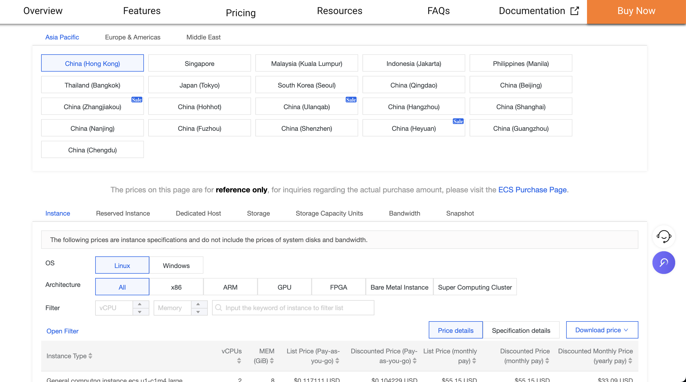
2. **环境配置**：Web 应用需要在特定"环境"中才能运行——例如运行 Node.js 项目必须先安装 Node.js；运行 Python 项目必须安装 Python 以及对应的第三方库。如果环境版本不匹配，程序就可能报错、无法启动。
3. **上传资源**：你需要把本地的代码和资源上传到服务器上，常用的方法包括 FTP 或 Git。如果项目体积比较大（比如包含视频文件），中途一旦断线，有时需要重新上传。

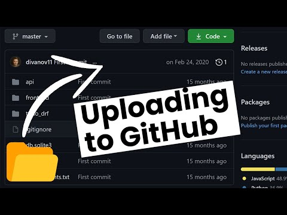

4. **启动服务并测试**：上传完成后，你还需要在服务器上执行命令启动应用，并测试"分配的网络地址是否能访问"。如果访问不了，有可能是服务器防火墙没有放行对应端口（比如你的应用监听 3000 端口，但该端口被防火墙拦截），也可能是程序本身有 Bug，这时就需要查看服务器日志进行排查。
   > 💡 可以把端口理解为区分同一台设备上不同应用的"房间号"，而 IP 则是这台设备的"门牌号"。IP 和端口合在一起（IP:port），就可以精确定位到某一个网络服务。
5. **维护与更新**：后续每次你修改代码，都要重新上传并重启服务。如果服务器宕机（例如断电、网络故障），还需要手动重启应用，有时还要额外配置"进程守护工具"，让程序在异常退出后自动拉起。

像 CloudBase、Vercel、Cloudflare Pages 这样的"低代码部署平台"，就是为了解决上述复杂问题而诞生的。它们会帮你自动完成"买服务器、配环境、上传代码、启动服务、监控运行"等步骤。你只需要把自己的代码仓库（比如 GitHub 或 GitLab）连接到平台，或者直接上传代码，它就会自动拉取代码、识别应用类型、配置对应的运行时环境，最后给你一个可以被任何人访问的公网地址。它甚至可以一键绑定你自己的域名。

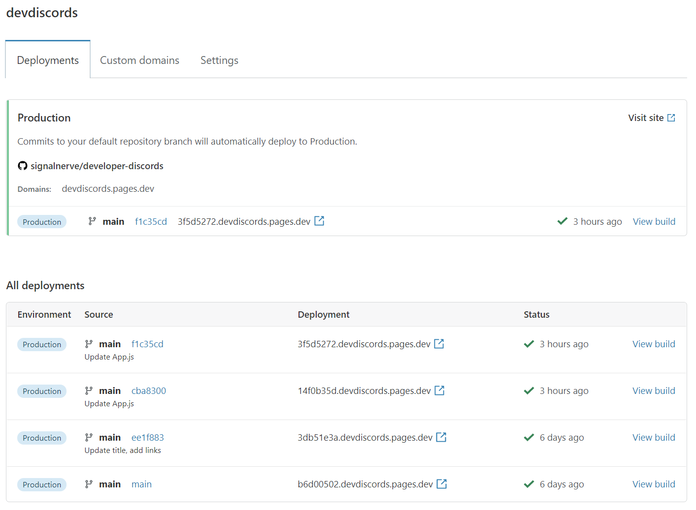

接下来，我们会分别介绍这些平台的特点和使用方法，帮助你选择最适合自己的部署方案。

---

# 部署平台对比

| 平台 | 特点 | 适用场景 | 免费额度 |
|------|------|----------|----------|
| **腾讯云 CloudBase** | 国内访问速度快，与微信生态深度整合 | 国内用户为主、需要微信小程序支持的项目 | 有免费额度 |
| **Vercel** | 前端框架支持好，与 GitHub 集成紧密 | React/Vue/Next.js 等现代前端项目 | 有免费额度 |
| **Netlify** | 功能全面，支持表单处理和身份验证，与 Git 集成好 | 需要表单处理、身份验证等高级功能的静态网站 | 有免费额度 |
| **Cloudflare Pages** | 支持本地上传和 Git 自动部署，提供 HTTPS 访问地址 | 静态网站、Vue / React 构建产物、小游戏 | 静态资源请求免费，构建和文件大小等有限制 |
| **Render** | 支持运行独立的 Node.js / Python 后端程序 | Express、Flask、FastAPI 等后端 API | 有免费 Web Service，闲置 15 分钟会休眠 |
| **Dify 官方云** | 注册后直接使用知识库、Agent 和工作流 | 学习与分享 Dify 应用，无需先自部署 | 有 Sandbox 免费方案，模型与知识库等额度有限 |

---

# 1. 腾讯云 CloudBase

腾讯云 CloudBase（云开发）是腾讯云提供的一站式后端云服务，特别适合国内开发者使用。它的优势在于：

- **国内访问速度快**：服务器位于国内，访问延迟低
- **微信生态整合**：可以方便地对接微信小程序、公众号
- **一站式解决方案**：提供静态网站托管、云函数、数据库、存储等全套服务
- **免费额度充足**：个人开发者有充足的免费资源额度

## 使用 CloudBase 部署 Web 应用

### 步骤 1：注册并登录

访问 [腾讯云 CloudBase 控制台](https://console.cloud.tencent.com/tcb)，使用微信或 QQ 登录。

### 步骤 2：创建环境

点击"新建环境"，选择一个环境名称（如 `my-web-app`）。

> ⚠️ **注意**：CloudBase 的免费体验版需要兑换码才能开通。你需要关注腾讯云 CloudBase 公众号，在公众号中输入"领取兑换码"获取免费体验版的兑换码，然后在创建环境时填写兑换码即可开通免费环境（免费试用期为 6 个月）。

### 步骤 3：开通静态网站托管

在环境管理页面，找到"静态网站托管"功能并开通。开通后你会获得一个默认的访问域名。

CloudBase 的静态网站托管提供多种部署方式：

- **本地项目上传**：直接从本地上传构建好的静态文件（HTML、CSS、JS 等）
- **模板部署**：使用预设模板快速创建项目，如 React Web 应用模板、Vue Web 应用模板
- **Git 仓库部署**：支持从 GitHub 等代码仓库自动拉取代码并部署

### 步骤 4：部署代码

在静态网站托管页面，CloudBase 提供三种部署方式：

**方式一：本地项目部署（本地项目上传）**
- 在控制台选择"本地项目部署"
- 直接上传构建好的静态文件（HTML、CSS、JS 等）
- 选择你本地构建好的项目文件夹（如 `dist` 或 `build` 目录）
- 等待上传完成即可访问

**方式二：模板部署**
- 使用预设模板快速创建项目
- 支持 React Web 应用模板、Vue Web 应用模板等
- 基于模板自动构建并部署

**方式三：Git 仓库部署**
- **Git 个人仓库部署**：绑定你的 GitHub 等个人代码仓库
- **公开仓库部署**：支持从公开的 Git 仓库拉取代码
- 配置自动构建命令（如 `npm run build`）
- 每次推送代码会自动重新部署

> 💡 **提示**：你也可以使用 CLI 工具进行部署：
> ```bash
> # 安装 CloudBase CLI
> npm install -g @cloudbase/cli
> # 登录
> tcb login
> # 部署
> tcb hosting deploy ./dist -e your-env-id
> ```

### 步骤 5：配置自定义域名（可选）

在静态网站托管设置中，可以绑定你自己的域名，并申请免费的 HTTPS 证书。

---

# 2. Vercel

Vercel 是全球最流行的前端部署平台之一，特别适合部署 React、Vue、Next.js 等现代前端框架项目。它的特点包括：

- **与 GitHub 深度集成**：推送代码即自动部署
- **自动预览**：每个 Pull Request 都会生成独立的预览链接
- **全球 CDN**：网站自动分发到全球节点，访问速度快
- **Serverless 函数**：支持在项目中编写后端 API

> ⚠️ **注意**：Vercel 在部分网络环境下访问可能不太稳定，国内用户建议优先考虑 CloudBase。

## 使用 Vercel 部署 Web 应用

### 步骤 1：注册账号

访问 [Vercel 官网](https://vercel.com)，使用 GitHub 账号登录。

### 步骤 2：导入项目

1. 点击 "Add New Project"
2. 选择你要部署的 GitHub 仓库
3. 如果没有看到想要的仓库，点击 "Adjust GitHub App Permissions" 授权访问

### 步骤 3：配置构建设置

Vercel 会自动识别项目类型并配置构建命令：

| 框架 | 构建命令 | 输出目录 |
|------|----------|----------|
| React | `npm run build` | `build` |
| Vue | `npm run build` | `dist` |
| Next.js | `next build` | - |
| 纯 HTML | - | 项目根目录 |

如果自动识别不正确，可以手动修改：
- **Build Command**: 构建命令，如 `npm run build`
- **Output Directory**: 构建输出目录，如 `dist` 或 `build`
- **Install Command**: 依赖安装命令，通常是 `npm install`

### 步骤 4：部署

点击 "Deploy" 按钮，等待构建完成。构建成功后，你会获得一个 `xxx.vercel.app` 的域名。

### 步骤 5：自定义域名（可选）

在项目设置中的 "Domains" 页面，可以添加你自己的域名。Vercel 会自动配置 HTTPS。

---

# 3. Netlify

Netlify 是另一个非常流行的前端部署平台，与 Vercel 类似，特别适合部署静态网站和单页应用（SPA）。它的特点包括：

- **功能全面**：除了静态网站托管，还支持表单处理、身份验证、边缘函数等高级功能
- **与 Git 深度集成**：支持 GitHub、GitLab、Bitbucket，推送代码自动部署
- **分支预览**：每个分支都会自动生成独立的预览链接
- **全球 CDN**：网站自动分发到全球节点，访问速度快
- **表单处理**：无需后端代码即可处理网站表单提交
- **身份验证**：内置用户身份验证功能，可快速实现登录/注册

> ⚠️ **注意**：Netlify 的国内访问速度可能不如 CloudBase，建议主要面向海外用户的项目使用。

## 使用 Netlify 部署 Web 应用

### 步骤 1：注册账号

访问 [Netlify 官网](https://www.netlify.com)，点击 "Sign up" 注册。你可以使用 GitHub、GitLab、Bitbucket 或邮箱注册。

### 步骤 2：导入项目

1. 登录后点击 "Add new site" → "Import an existing project"
2. 选择你的代码托管平台（如 GitHub）
3. 授权 Netlify 访问你的仓库
4. 从列表中选择你要部署的仓库

### 步骤 3：配置构建设置

Netlify 会自动识别常见的前端框架并配置构建设置：

| 框架 | 构建命令 | 发布目录 |
|------|----------|----------|
| React | `npm run build` | `build` |
| Vue | `npm run build` | `dist` |
| Angular | `ng build` | `dist/<project-name>` |
| Next.js | `next build` | `out` |
| 纯 HTML | - | `.`（项目根目录） |

如果自动识别不正确，可以手动配置：
- **Build command**: 构建命令，如 `npm run build`
- **Publish directory**: 构建输出目录，如 `dist` 或 `build`

### 步骤 4：部署

点击 "Deploy site" 按钮，等待构建完成。构建成功后，你会获得一个 `xxx.netlify.app` 的域名，任何人都可以通过这个地址访问你的网站。

### 步骤 5：配置自定义域名（可选）

1. 进入站点设置，点击 "Domain management"
2. 点击 "Add custom domain"
3. 输入你的域名并按照提示配置 DNS 记录
4. Netlify 会自动申请并配置 HTTPS 证书

### 特色功能

#### 1. 表单处理

Netlify 提供了一个非常方便的功能：无需后端代码即可处理表单提交。

只需在 HTML 表单中添加 `netlify` 属性：

```html
<form name="contact" netlify>
  <p>
    <label>姓名: <input type="text" name="name" /></label>
  </p>
  <p>
    <label>邮箱: <input type="email" name="email" /></label>
  </p>
  <p>
    <label>留言: <textarea name="message"></textarea></label>
  </p>
  <p>
    <button type="submit">发送</button>
  </p>
</form>
```

部署后，表单提交的数据会自动发送到 Netlify 后台，你可以在 "Forms" 页面查看所有提交记录，也可以设置邮件通知或将数据转发到其他服务。

#### 2. Netlify Functions（边缘函数）

Netlify 支持部署无服务器函数（Serverless Functions），让你可以在不搭建完整后端服务器的情况下，实现简单的 API 接口。你可以使用 JavaScript 或 TypeScript 编写函数，部署后会自动获得一个可访问的 URL。

例如，创建一个 `hello.js` 文件：

```javascript
exports.handler = async (event, context) => {
  return {
    statusCode: 200,
    body: JSON.stringify({ message: "Hello from Netlify!" })
  };
};
```

部署后，你可以通过 `https://你的域名/.netlify/functions/hello` 访问这个函数。

#### 3. 本地开发支持

Netlify 提供了 CLI 工具，方便你在本地开发和测试：

```bash
# 安装 Netlify CLI
npm install -g netlify-cli

# 登录账号
netlify login

# 本地启动开发服务器
netlify dev

# 本地测试函数
netlify functions:serve
```

使用 CLI 工具可以在本地模拟 Netlify 环境，包括表单提交、函数调用等功能，方便在部署前进行测试。

---

# 4. Cloudflare Pages

Cloudflare Pages 是一个用于发布网页的平台。它特别适合纯 HTML 网页、Vue / React 项目和文档网站，优点包括：

- **本地文件上传**：把已经生成的网页文件上传后，就能得到访问地址
- **Git 自动部署**：连接 GitHub 或 GitLab 后，推送代码会自动构建和更新网站
- **自动 HTTPS**：平台会提供可公开访问的 `pages.dev` 地址，也支持自定义域名
- **有免费方案**：静态资源请求免费，构建次数和文件大小等仍有上限；动态函数另按 Workers 规则计算

## 使用 Cloudflare Pages 与 Trae 部署贪吃蛇游戏

在本教程的下一个部分，我们会实际发布一个网页游戏。我们先用 Trae 生成一个贪吃蛇小游戏，再把它部署到 Cloudflare Pages，并取得一个可公开访问的链接，让其他人也能打开游戏。

第一步，是在本地使用 Trae 创建一个贪吃蛇项目。

### 使用 HTML 框架实现

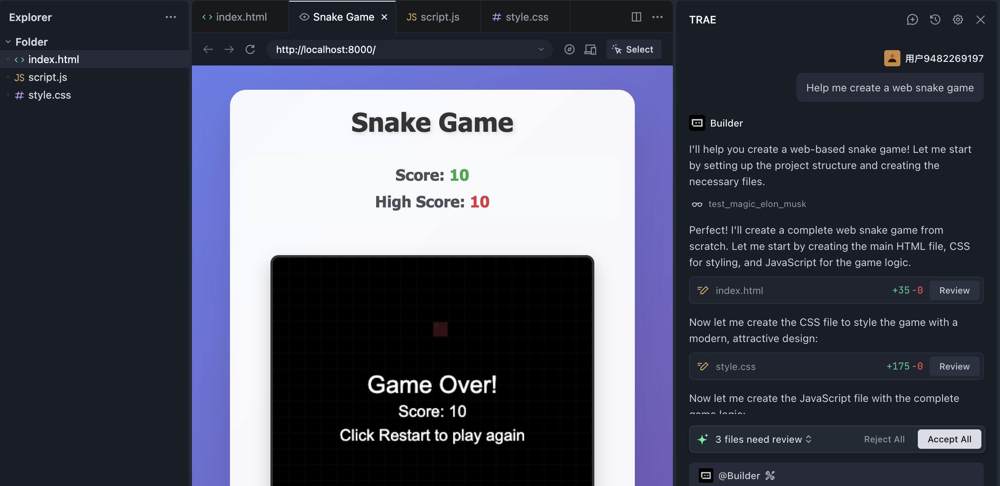

对于 Trae 来说，生成一个基于 HTML 的贪吃蛇网页游戏非常简单。游戏生成后，我们需要找到包含 `index.html`、CSS、JavaScript 等文件的文件夹。可以先让 Trae 检查：这个文件夹是否包含运行游戏所需的全部资源，是否还依赖只在本机存在的文件路径。

接下来，访问 [Cloudflare 控制台](https://dash.cloudflare.com/)，注册并登录。在左侧进入 **Workers & Pages**，创建应用时选择 **Pages** 的文件上传入口，界面可能显示为 `Get started` 或 `Drag and drop your files`。

这里有两种方式：

1. **直接上传（Direct Upload）**：适合现在这个已经在本地生成好的 HTML 小游戏。
2. **连接 Git（Git integration）**：适合后续持续修改代码，希望每次推送后自动更新网站的项目。

这次先选择直接上传。输入项目名称，把包含 `index.html` 的文件夹拖入上传区域，再点击部署。这里上传的是网页文件，不是 `node_modules`，也不是一个需要运行开发服务器才能访问的完整源码目录。

部署完成后，Cloudflare 会给出一个类似 `https://项目名.pages.dev` 的访问地址。打开这个地址，测试游戏能否开始、按键能否控制、图片和样式能否正常加载。以后更新游戏时，修改代码，再创建一次新部署并上传更新后的文件即可。

> 直接上传与 Git 集成是两种项目创建方式。直接上传的 Pages 项目不能直接切换成 Git 集成；需要自动发布时，可以另建一个连接 Git 的项目。具体入口见 [Cloudflare 官方上传指南](https://developers.cloudflare.com/pages/get-started/direct-upload/)。

### 使用 React 框架实现

前面我们学习了如何部署基于 HTML 的 Web 应用。接下来，我们再尝试部署一个目前更常用的前端框架：React 应用。相比纯 HTML，React 通过组件化的方式组织页面结构，能够帮助我们管理更复杂的交互界面。

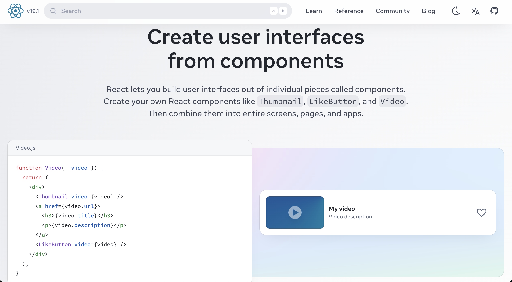

#### 重构为 React 架构

在 Trae 中，可以向 Agent 说明：“帮我把这份代码重构成 React 架构，使用 Vite 构建，并保留现有的游戏功能。”

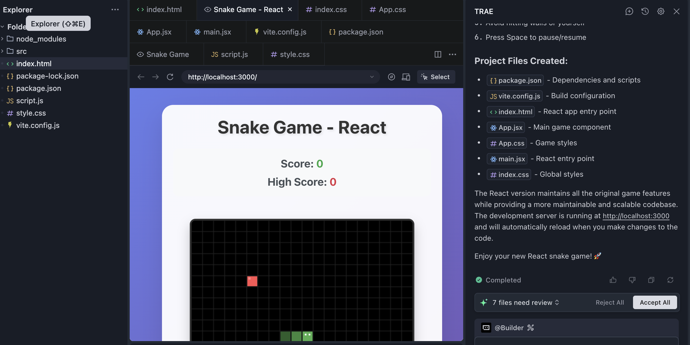

重构完成后，先在本地运行并测试。然后让 Trae 执行构建命令：

```bash
npm install
npm run build
```

Vite 项目通常会生成一个 `dist` 文件夹。打开这个文件夹，可以看到 `index.html` 和经过构建的脚本、样式等文件。现在需要上传到 Cloudflare Pages 的是 **`dist` 里面的构建产物**，不是 React 源码目录。

也可以直接把下面的要求发给 Trae：

```text
请检查这个 React 项目能否部署到 Cloudflare Pages：
1. 确认使用的构建工具、构建命令和输出目录，不要只根据 React 这个名字猜测。
2. 在本地执行构建，修复构建报错。
3. 检查图片、脚本和页面路由，避免依赖本机绝对路径。
4. 告诉我应该上传哪个文件夹。如果使用 Git 部署，列出需要填写的构建设置。
```

#### 从 GitHub 自动部署

如果代码已经上传到 GitHub，可以在 Pages 中选择连接 Git 仓库，授权后选择项目和生产分支，例如 `main`。

首先设置项目名称和分支。下面的界面图来自 [Cloudflare 官方 Git 集成指南](https://developers.cloudflare.com/pages/get-started/git-integration/)，截图中的示例项目名称不需要照抄。

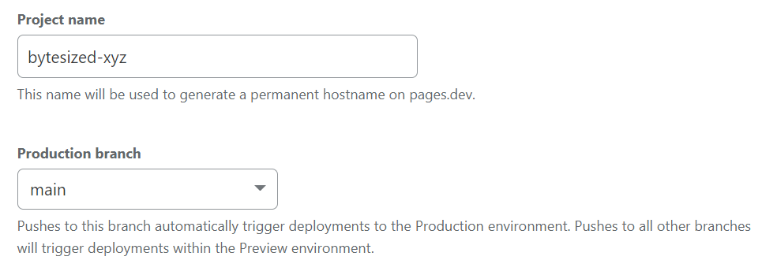

接下来填写构建设置。Vite 创建的 React / Vue 项目通常使用：

| 设置项 | 本例填写内容 | 含义 |
| --- | --- | --- |
| Framework preset | 按实际框架选择 | 帮助平台识别项目 |
| Build command | `npm run build` | 安装依赖后执行的构建命令 |
| Build output directory | `dist` | 平台对外发布的文件目录 |
| Root directory | 项目所在目录 | 如果代码就在仓库根目录，使用默认设置 |

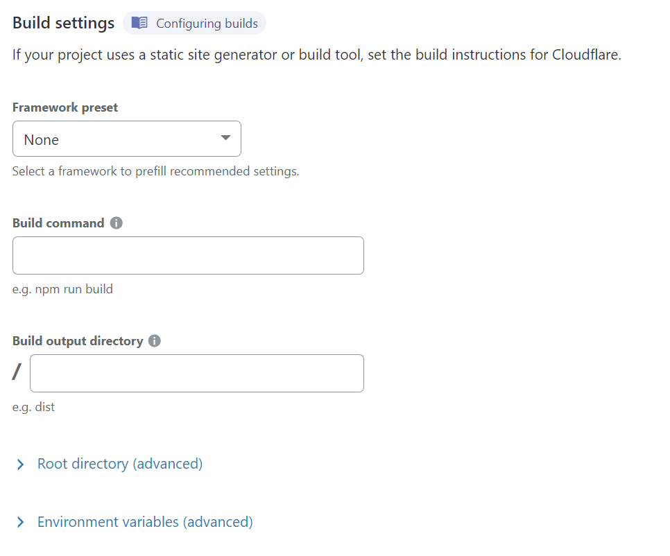

> 配图来自官方指南的示例项目，可能显示其他框架和输出目录；本例填写上表中的 Vite 设置。旧的 Create React App 通常输出 `build`，不能把所有 React 项目都当作 `dist`。

保存并部署后，平台会安装依赖、构建并发布网站。构建失败时，先看日志里最早出现的错误，再让 AI 根据错误信息修改代码或配置。

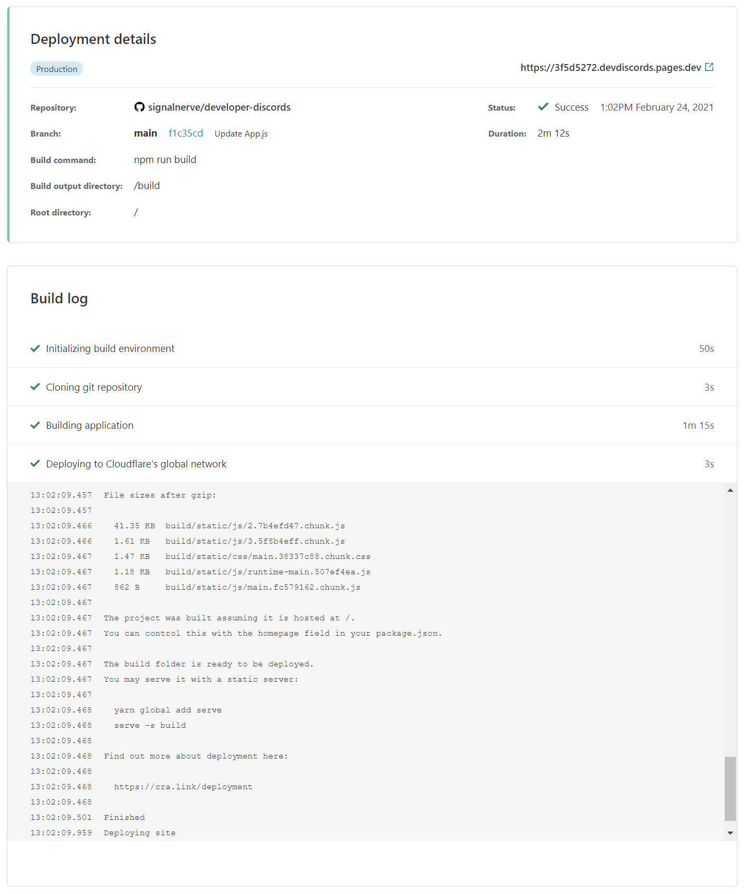

部署成功后，在项目页面取得公开访问地址。之后推送到所选生产分支，就会触发一次新的部署。


如果页面空白、图片或脚本返回 404，优先检查构建输出目录，以及 Vite 的 `base` 配置。原本为 GitHub Pages 仓库子路径配置的 `/项目名/`，不一定适合独立域名根目录。

#### 本地监听端口与线上静态网站有什么区别？

在 Trae 的本地预览里，可能会看到 `localhost:3000` 或 `localhost:5173`。这表示我们通过本机开发服务器查看网页。React 本身并不规定端口，具体数字由开发工具和项目配置决定。

> 在计算机网络中，端口可以理解为一个“逻辑通信端点”，用来区分同一台设备上运行的不同网络服务。简单类比的话，如果 IP 地址好比一个“门牌号”，端口号就像这栋楼里不同房间的“房间号”——每个房间对应一个服务。
>
> 端口号用 16 位整型表示，取值范围是 0 到 65535。

“监听端口号”指的是某个程序主动打开并等待请求的端口。假设电脑是一栋写字楼，开发服务器在 3000 号房间接收请求，操作系统就会把发送到这个端口的请求交给它。

我们平时访问网站时，通常不需要手动添加端口，因为浏览器访问 HTTP、HTTPS 时分别默认使用 80、443。把构建产物上传到 Cloudflare Pages 后，网页文件由平台提供访问服务，不需要把本地开发服务器的端口改成某个固定数字。

如果项目除了网页，还需要一直运行 Node.js / Python 后端，就不能只上传静态产物。下面我们继续介绍这种情况。

---

# 5. Render

Render 可以运行独立的后端程序。比如前端发来一条聊天消息，后端需要读取 API Key、请求模型并返回结果，这部分程序可以部署在 Render，而网页仍然放在 Cloudflare Pages、Vercel 等平台。

它支持连接 Git 仓库、配置启动命令和环境变量，并为服务提供 HTTPS 地址。免费 Web Service 适合学习和演示，但连续 15 分钟没有入站流量后会休眠，下一次访问需要等待唤醒。

## 使用 Render 部署后端 API

### 步骤 1：准备能够启动的后端项目

如果已经有 Express、Flask 或 FastAPI 项目，先让 Trae 检查依赖文件、启动命令和监听地址。以 Node.js / Express 为例，可以在一个新的练习文件夹中执行：

```bash
npm init -y
npm install express
npm pkg set type=module
npm pkg set scripts.start="node server.js"
```

创建 `server.js`：

```javascript
import express from 'express'

const app = express()

app.get('/health', (req, res) => {
  res.json({ status: 'ok' })
})

const port = Number(process.env.PORT || 3000)
app.listen(port, '0.0.0.0', () => {
  console.log(`Server listening on port ${port}`)
})
```

先运行 `npm start`，再打开 `http://localhost:3000/health`。看到 `{"status":"ok"}`，说明程序已经能够响应请求。

这里的 `process.env.PORT` 用来读取 Render 提供的端口。监听地址使用 `0.0.0.0`，使平台能够把请求交给程序。不要把线上端口固定为本地开发时的数字，也不要只监听 `127.0.0.1`。

把 `server.js`、`package.json`、`package-lock.json` 上传到 GitHub。`node_modules` 和保存真实密钥的 `.env` 应加入 `.gitignore`，不要上传。

### 步骤 2：连接仓库

访问 [Render 控制台](https://dashboard.render.com/)，注册并登录。点击右上角的 **New**，选择 **Web Service**。

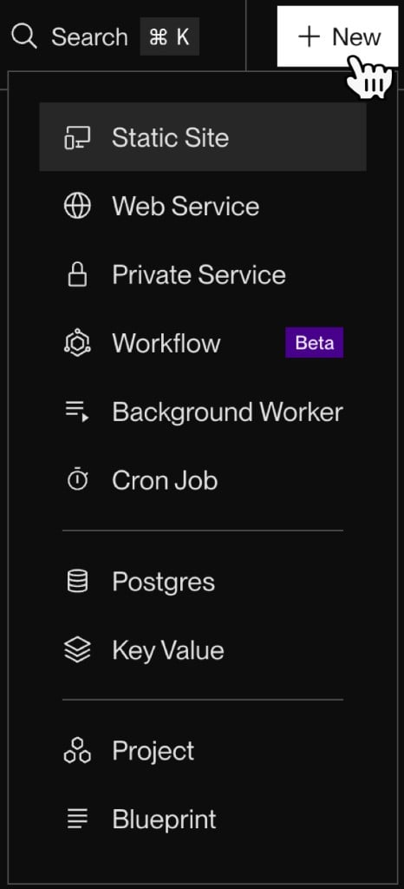

选择 Git Provider，连接 GitHub，并授权需要部署的仓库。授权后，在仓库列表中找到项目并点击连接。

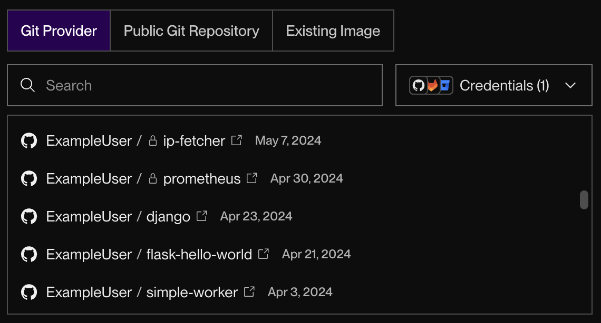

以上界面图来自 [Render 官方首次部署指南](https://render.com/docs/your-first-deploy)。账户中显示的仓库名称会不同，以自己的项目为准。

### 步骤 3：配置构建与启动命令

给服务取一个名称，选择区域、分支和语言。本例选择 Node，填写：

| 设置项 | 本例填写内容 |
| --- | --- |
| Root Directory | 代码在仓库根目录时留空；如果在 `server` 等子目录，则填写该目录 |
| Build Command | `npm ci`，本例已经包含 `package-lock.json` |
| Start Command | `npm start` |
| Instance Type / Compute | `Free` |

TypeScript 项目通常还需要编译；Python 项目则需要填写自己的依赖安装与生产启动命令。这些设置应根据实际代码确定，不能直接照抄 Node 示例。

选择实例时，确认选中的是 **Free**。后续如果另外添加数据库或其他服务，也要分别检查它们的套餐。


### 步骤 4：配置环境变量并部署

如果后端要调用 Dify 或模型服务，在 Environment 中填写服务端需要的环境变量，例如 `DIFY_API_KEY`。这些变量由后端读取，不放进前端代码；`VITE_`、`NEXT_PUBLIC_` 等公开变量也不适合保存密钥。

点击创建 Web Service 后，Render 会开始构建。打开 Deploys / Logs 查看依赖安装和程序启动过程。

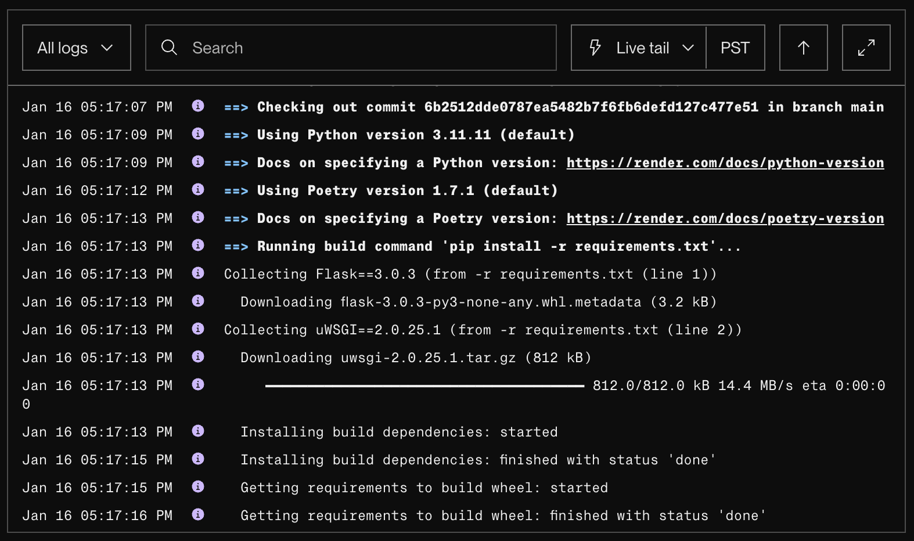

### 步骤 5：取得地址并测试接口

当服务状态变为 **Live**，在服务页面找到 `onrender.com` 地址。

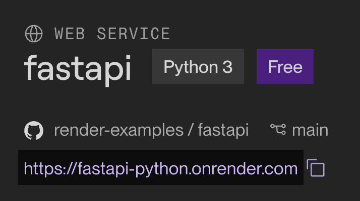

本例需要访问的是 `https://服务名.onrender.com/health`，而不是只打开根路径。看到和本地相同的 JSON，说明部署已经成功。

接下来，把前端接口地址改成自己的 Render 域名。如果前后端不在同一个域名，后端还需要为实际前端来源配置 CORS，并处理浏览器的 `OPTIONS` 预检请求。

> **免费服务的存储限制**：免费 Web Service 不能挂载持久化磁盘，本地上传文件或 SQLite 数据不能当作长期存储。免费 Render Postgres 在创建 30 天后到期；需要长期保存数据时，按数据库课程选择合适的持久化方案。当前规则见 [Render 免费服务说明](https://render.com/docs/free)。

---

# 6. Dify 官方云

在之前的课程中，我们已经简单接触过 Dify。学习知识库、Agent 和工作流时，可以直接使用 [Dify 官方云](https://cloud.dify.ai/apps)，不需要先买服务器、找模板或等待多个服务启动。

## 使用 Dify 官方云创建应用

### 步骤 1：注册并进入工作区

打开 Dify 官方云，注册并登录，进入自己的工作区。学习阶段可以先使用 **Sandbox** 免费方案。免费托管有应用、知识库、文档和消息等额度限制，具体以 [当前价格页](https://www.dify.ai/pricing) 为准。

进入 Studio 后，可以看到应用列表以及创建入口。下面复用本课程 Dify 章节的操作截图，不同版本的布局可能稍有变化。

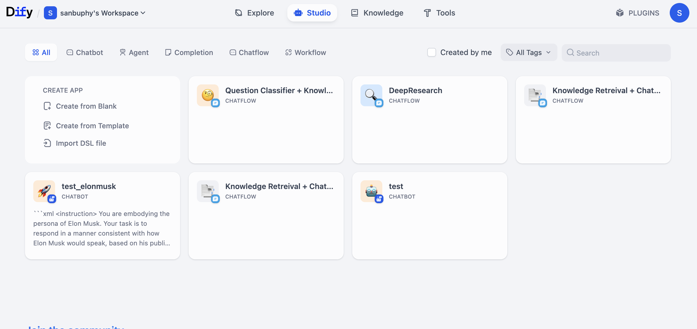

这里的 **Create from Blank** 用于从空白创建应用，**Create from Template** 用于使用模板，**Import DSL file** 用于导入已有工作流。它们创建的是 Dify 里的应用，不是另起一台云服务器。

### 步骤 2：创建一个 Chatbot

点击 **Create from Blank**，选择 Chatbot，填写应用名称和描述，再点击创建。

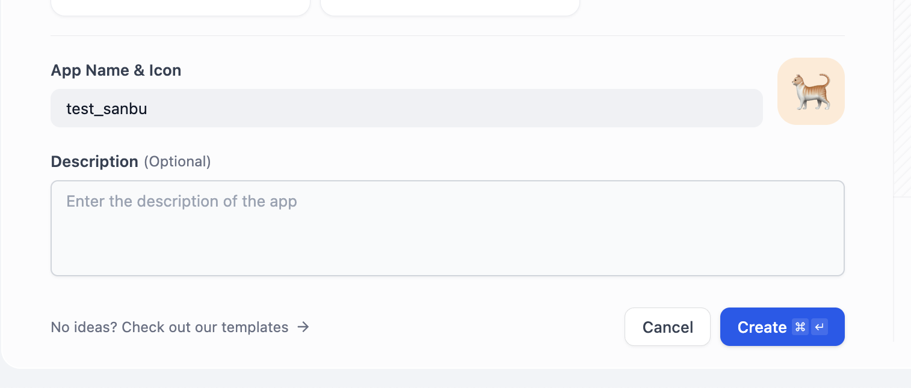

如果创建入口提示应用数量已到上限，先检查当前工作区额度，而不是反复重新部署。模型供应商也需要有可用模型和额度；使用自己的模型 API Key 时，费用按照模型供应商规则计算。

知识库上传、检索测试、Agent 和工作流的具体配置，继续参考 [Dify 入门与知识库集成](../../ai-capabilities/dify-knowledge-base/)。

### 步骤 3：测试并分享应用

先在应用的预览区域完成一次对话，确认模型能回答，知识库能检索到预期资料。再打开右上角 **Publish**，发布当前配置，并通过 **Run App** 打开应用页面。

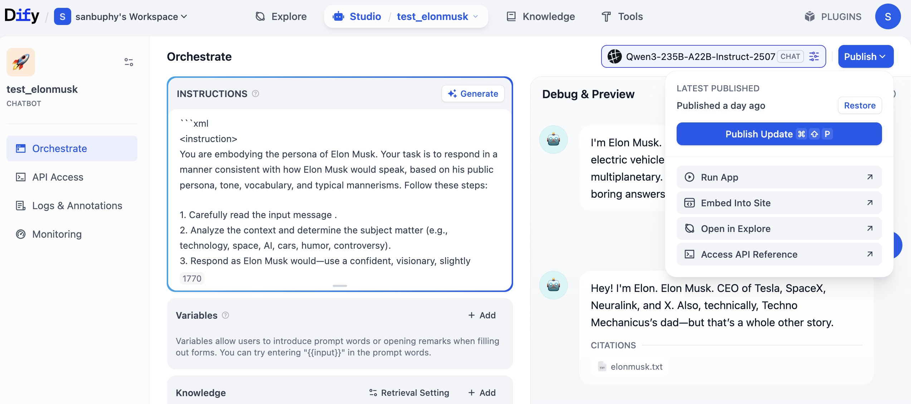

复制实际的 WebApp 地址，用另一个浏览器窗口测试应用的访问设置。需要登录才能访问的应用，应按当前设置完成登录，不要把自己的 Studio 管理地址当成分享地址。

## 将 Dify 接到自己的网页

如果希望使用自己制作的聊天界面，可以在应用 API 文档中取得调用地址和密钥。Dify Cloud 的 API 基础地址为 `https://api.dify.ai/v1`，自部署则使用实例自己的 API 地址。

浏览器先请求自己的后端，由后端读取 `DIFY_API_KEY`，再调用 Dify。后端可以使用前面介绍的 Render。不要把 Dify 应用密钥直接放进前端源码或浏览器请求里。

## 什么时候再考虑自部署？

需要控制 Dify 实例、插件或运行环境时，可以按 [Dify 官方 Docker Compose 指南](https://docs.dify.ai/en/self-host/deploy/quick-start/docker-compose) 部署到自己的电脑或云服务器。当前最低硬件要求为 2 核 CPU、4 GiB 内存，具体需求还取决于版本和使用量。

开源软件可以自行部署，不代表服务器、存储、流量和模型调用都免费。自部署作为后续进阶路径，不再作为本节使用 Dify 的必做前置步骤。

---

# ⚠️ 如何停止和删除项目

实验结束后，需要分别检查网站、后端和数据库。暂停一个网页服务，不代表相关数据库、磁盘或其他资源也已经停止计费。

## Cloudflare Pages

打开项目的 Settings，在删除项目入口按提示确认。需要保留代码时，先确认源码已保存在 Git 仓库；绑定自定义域名的项目，也要按平台要求清理域名记录。可以在 [官方项目管理说明](https://developers.cloudflare.com/pages/get-started/git-integration/#delete-a-project) 中核对当前入口。

## Render

在服务的 Settings 中找到暂停或删除入口，按控制台提示操作。删除服务前先备份需要的数据；单独创建的数据库和其他资源也需要分别检查。

## Dify 官方云

学习完成后，可以在应用设置中删除不再使用的应用；需要复用的工作流先导出 DSL。删除应用不等于注销账号或取消已订阅的付费套餐，使用付费方案时还要单独检查 Billing。

---

# 总结

在本教程中，我们介绍了几种可用的发布方式：

1. **腾讯云 CloudBase**：适合结合腾讯云生态发布网站或后端
2. **Vercel**：适合现代前端框架和 Next.js 项目，与 GitHub 集成紧密
3. **Netlify**：适合静态网站与 Git 自动发布，也提供表单和函数等功能
4. **Cloudflare Pages**：适合静态网页、Vue / React 构建产物和小游戏
5. **Render**：适合独立后端，免费实例有休眠与存储限制

选择哪个平台取决于项目需要什么。纯网页先选择静态托管，独立后端选择能运行该程序的服务，学习 Dify 则可以直接从官方云开始。

无论选择哪个平台，部署的核心流程都是相似的：准备代码 → 选择平台 → 配置构建设置 → 部署上线。完成后，再用实际访问地址验证页面和接口是否能够正常工作。
